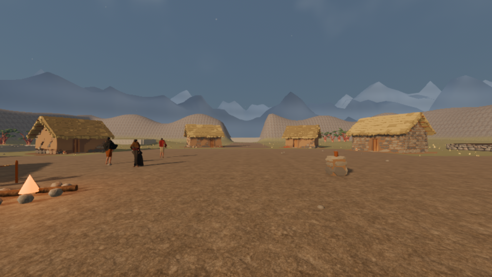
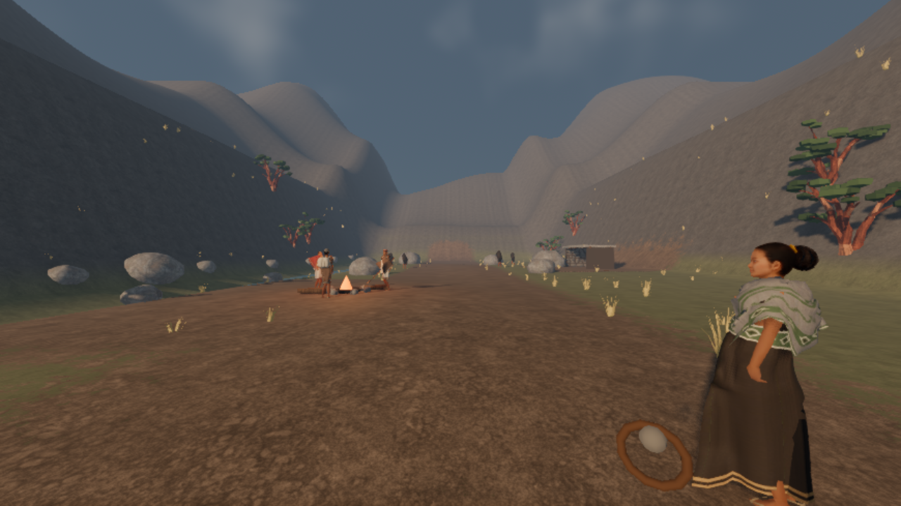
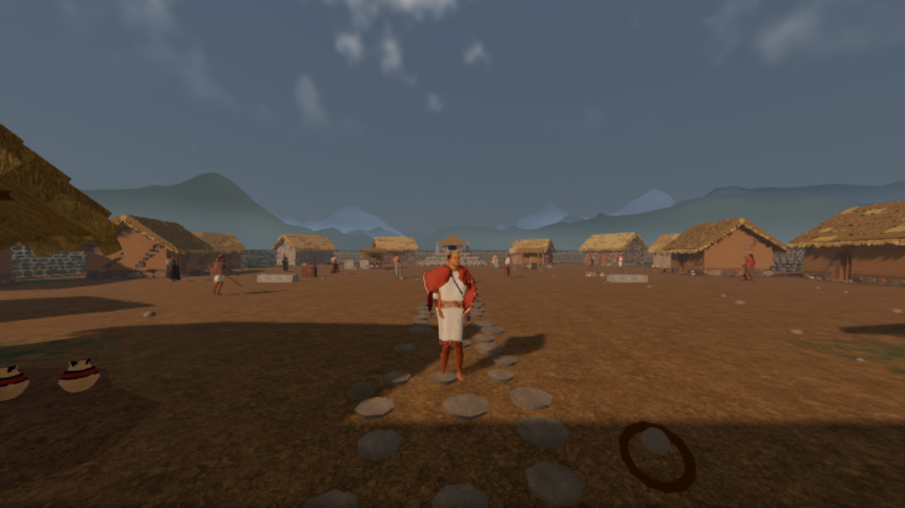
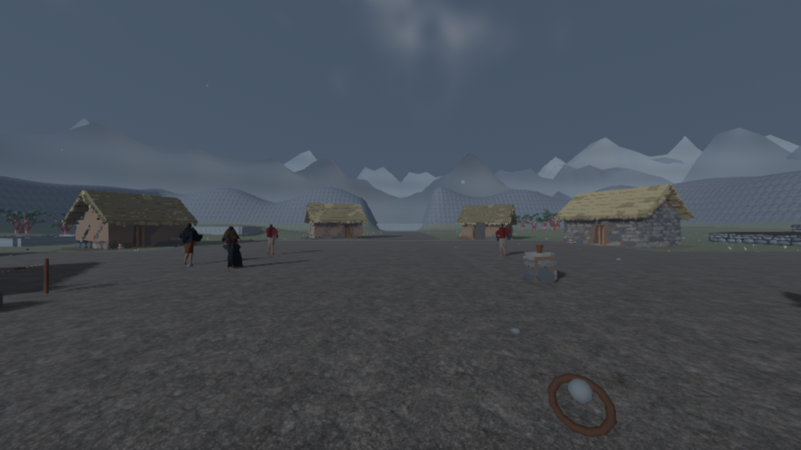
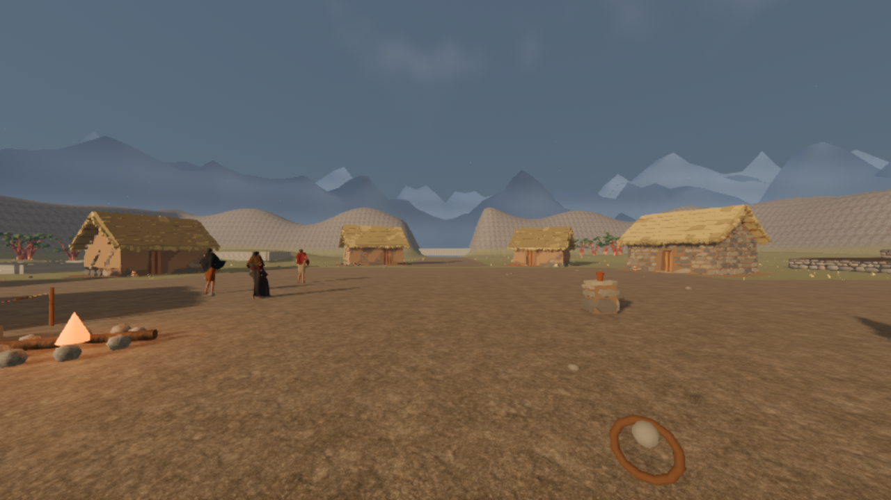
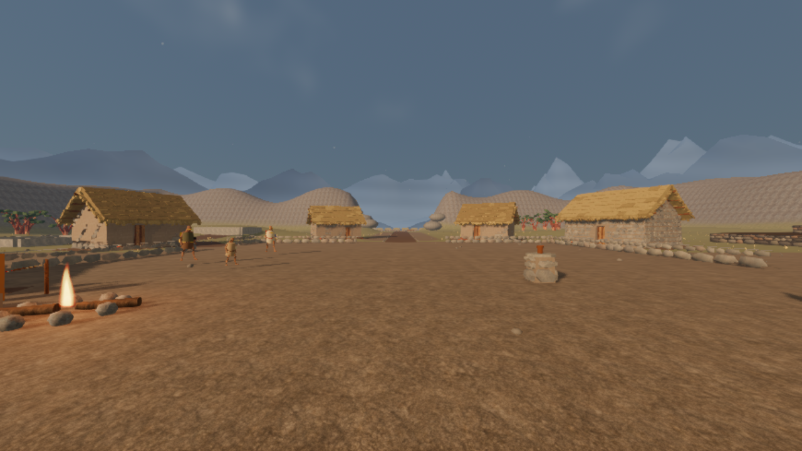
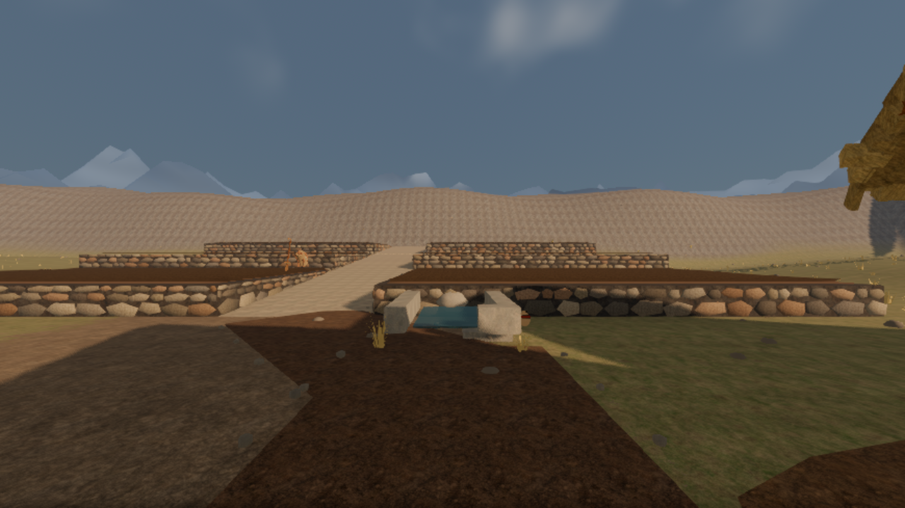
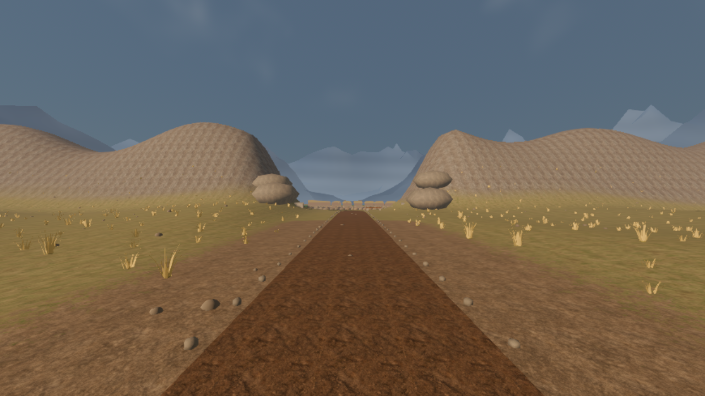
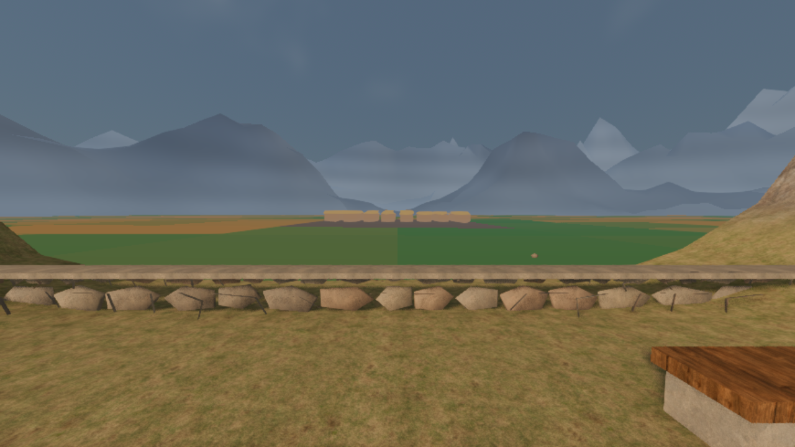
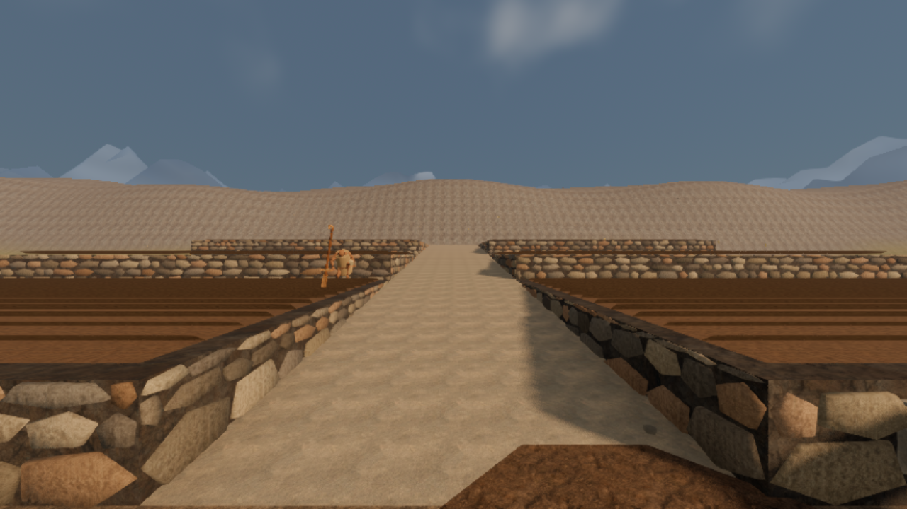

# Guía visual — campaña 01, *Pachacútec: El despertar del Sol*

**Estado:** v1.0 · 2026-11-16 · Fase 4.9.
**Manda:** [docs/09](../../../docs/09_biblia_narrativa.md) en lo narrativo,
[docs/07](../../../docs/07_convenciones_historicas.md) en lo histórico y este documento
en lo visual. Si una pieza incumple una regla, se corrige la pieza; si la regla no sirve,
se cambia aquí y se anota en la [bitácora](../../../docs/bitacora.md).

La guía existe para que los cinco actos parezcan **el mismo mundo visto a distintas
horas**, no cinco escenarios ensamblados. No pide más assets: decide cómo se iluminan,
se componen y se limitan los que ya hay.

## 1. Idea visual

**Low poly detallado con luz de altura.** Geometría simple, siluetas legibles y
materiales propios (piedra, adobe, ichu, tierra, tejido), con la luz y la bruma haciendo
el trabajo. La identidad no viene de la resolución de las texturas, sino de la paleta, la
escala y las formas andinas.

Tres reglas que resumen el resto:

1. **La luz es el personaje principal.** Sol bajo, sombras largas, contraste cálido/frío.
2. **El paisaje se queda en ocres, grises y verdes secos.** Los colores saturados se
   reservan para las facciones y los objetos de juego.
3. **Nada de formas que digan «medieval europeo».** Pirca irregular, adobe, ichu; nada de
   sillares imperiales, arcos de medio punto, tejas, chimeneas ni entramados.

## 2. Paleta por acto

Cada paleta vive en un `PaletteTuning`
(`campaigns/01_pachacutec/resources/palettes/`) y la aplica el
`EnvironmentQualityController` de la escena. Cambiar un color se hace en el `.tres`, no
en el `.tscn`.

| Acto | Paleta | Sol | Ambiente | Niebla | Lectura |
|---|---|---|---|---|---|
| I — Llacta | `paleta_llacta.tres` | `#FFD6A8` · 1,30 · −22° | `#B8AD9C` · 0,95 | `#A8BDDB` · 0,0016 | Media mañana, polvo dorado, comunidad viva |
| II — Paso | `paleta_paso.tres` | `#FFDBB3` · 1,20 · −20° | `#ABB3BF` · 0,90 | `#A3B8D1` · 0,0030 | Altura fría, aire fino, piedra y viento |
| III — Cusco | `paleta_ciudad.tres` | `#FFD1A8` · 1,08 · −28° | `#B3A899` · 0,86 | `#A8B3C7` · 0,0024 | Tarde de defensa, luz rasante, humo |
| IV — Posguerra | `paleta_posguerra.tres` | `#C2D9FF` · 0,85 · −22° | `#9EB3D6` · 0,75 | `#99ADD1` · 0,0022 | Frío, humedad, ausencia |
| V — Obra | `paleta_obra.tres` | `#FFDEB3` · 1,25 · −18° | `#BDB39E` · 0,95 | `#ADBDD6` · 0,0016 | Amanecer que vuelve, polvo de obra |

**Cielo:** Rayleigh `#4D80E6` (I, III, V), `#5785DB` (II), `#577AB3` (IV); suelo del
cielo `#2E2921` (I, V), `#292621` (II), `#2E2921` (III), `#24262A` (IV). La turbidez sube
en la posguerra (2,2) para que el cielo pese.

**Acentos de facción:** inca rojo `#B3241A` y amarillo `#DBA829`; chanca `#296B85`.
Son los únicos colores muy saturados del paisaje. Si un tejido o un objeto compite con
ellos, se desatura.

| Acto | Captura de referencia |
|---|---|
| I — Llacta |  |
| II — Paso |  |
| III — Cusco |  |
| IV — Posguerra |  |
| V — Obra |  |

Las capturas son del punto de aparición de cada escena, con el HUD oculto. No son
encuadres de marketing: sirven para comparar la luz y la paleta entre actos.

## 3. Escala

| Elemento | Medida | Nota |
|---|---|---|
| Persona | 1,70 m | Referencia para todo lo demás |
| Puerta de casa | 0,9 × 1,7 m | Rectangular por defecto; la trapezoidal se decide aparte |
| Casa de un ambiente | 4,4–7,0 m de ancho, 3,8–5,4 m de fondo y 2,0–2,5 m de muro | `HouseKit` ajusta la colisión a cada variante; puerta de 0,9 × 1,7 m |
| Muro de terraza | 1,4–1,8 m de alto, 0,6 m de grueso | Pirca seca, hiladas irregulares |
| Peldaño | 0,2 m de alto, 0,3 m de huella | El jugador sube ~0,1 m solo: escaleras con rampa de colisión |
| Techo de ichu | Cumbrera +1,6–1,8 m, alero 0,4 m | Grueso: se ve el canto |
| Plaza | 27 × 27 m | Borde de pirca baja con cuatro entradas; espacio para la asamblea |
| Camino | 3,0 m de ancho | Cinta de tierra y piedras de borde; sin props a menos de 3 m |
| Manantial | Pileta de 3,2 × 2,0 m | Agua, acequia corta y juncos; al pie de la primera terraza |
| Mirador | Parapeto de 14 m y 0,72 m de alto | En el paso norte; mira al fondo de valle |
| Santuario | Gradas de 3–4 niveles | Pirca, no cantería imperial |
| Apus | 250–420 m sobre el valle, a 1,5–2,5 km | Sin niebla: el color lleva la atmósfera |

## 3.1 Composición del territorio (2026-11-18)

La llacta ya no es una plaza plana con casas en anillo: el camino es la espina y
el borde de la plaza separa el recinto de los campos. Las reglas que se aplican:

- **Camino visible**: cinta de tierra de 3 m, algo más oscura que el terreno, con
  piedras de borde en `MultiMesh`. Los caminos salen de la plaza por cuatro
  entradas y llevan a la casa de Rumi, el manantial, el maíz, el telar, la pirca,
  los corrales y el mirador del norte.
- **Borde de plaza**: pirca baja de 0,68 m con cuatro huecos alineados con los
  caminos. No encierra al jugador: le dice dónde está la plaza.
- **Manantial y acequia**: pileta de piedra, agua oscura, juncos y un canal corto
  hacia la primera terraza. La tarea «Acarrear agua» se lee junto a la pileta.
- **Mirador del norte**: el camino sube hasta un parapeto bajo en el paso; desde
  allí se ven los campos, el caserío y las montañas. El fondo no se recorre.
- **Vivienda**: cada variante tiene su ancho, fondo y colisión; la escala y el
  tinte rompen la repetición. La puerta mira al camino.
- **Roquedales**: cuatro bloques de piedra enmarcan el paso y dan una silueta de
  montaña, no de colina lisa.

| Vista | Captura |
|---|---|
| Plaza y borde |  |
| Manantial |  |
| Camino del norte |  |
| Mirador |  |
| Terrazas |  |

## 4. Formas y materiales

- **Pirca:** piedras irregulares sin mortero, hiladas desiguales, cada piedra de un tono.
  Nada de sillares regulares: la cantería fina es del Cusco imperial posterior.
- **Adobe:** volúmenes simples, esquinas ligeramente blandas, sin vanos decorativos.
- **Ichu:** techos a dos aguas, gruesos, con alero y capas escalonadas para que se lean
  como paja y no como plancha.
- **Terreno:** facetado, sin texturas de alta frecuencia; la variación sale del color por
  vértice y de la maleza.
- **Madera:** solo vigas necesarias, oscura y sin entramados decorativos.
- **Tejido:** lana con trama visible de cerca; los colores de facción, solo en la ropa y
  los tocados.

## 5. Luz y composición

- **Sol bajo:** entre −18° y −28° según el acto. Sombras largas que marcan terrazas,
  muros y caras.
- **Contraste térmico:** sol cálido, sombras azuladas. La posguerra invierte el énfasis:
  sol frío, ambiente gris, fuego ausente.
- **Bruma:** la niebla de altura separa planos; el fondo se pinta con su propio color
  atmosférico y sin niebla para que no se lave.
- **Composición:** el camino, el muro y la casa deben leerse como líneas; la plaza no es
  un descampado, tiene borde, mercado y santuario. El jugador mira a algo.
- **Nada de saturación global:** si la escena parece una postal, se baja la saturación
  del paisaje, no la de los personajes.

## 6. Qué evitar

- Almenas, torres, arcos de medio punto, contrafuertes.
- Tejas de barro, chimeneas, vigas vistas, entramados, ventanas con parteluz.
- Sillares regulares o muros ciclópeos (son del Cusco imperial posterior).
- Vegetación de bosque europeo: aquí ichu, matorral seco y pocos árboles.
- Colores saturados en el paisaje; se reservan para facciones y objetos.
- Cualquier elemento colonial o de otra cultura (`docs/07`, «Lo que no se cambia»).
- Retratos y voces: la biblia de la campaña los excluye; no son deuda.

## 7. Cómo se comprueba

Las capturas de referencia se generan con:

```bash
godot --path . --resolution 1280x720 res://tests/scenes/capture_palettes.tscn
```

El comando deja `user://paleta_<acto>.png`. Las imágenes se copian a
`docs/img/guia_visual/` y se revisan en el monitor de referencia. La escena de captura
carga los cinco mundos, espera a que los generadores terminen y guarda un fotograma por
acto.

La composición del territorio se revisa con capturas fijas y un recorrido real:

```bash
godot --path . --resolution 1280x720 res://tests/scenes/capture_llacta_tour.tscn
godot --headless --path . --script res://tests/llacta_walk_check.gd
```

Las capturas van a `/tmp/opencode/llacta_tour/`. La segunda comprueba que el
jugador llega a la plaza, el manantial, la casa, el mirador y los corrales sin
atascarse.

El procedimiento completo —tomas fijas, comparación antes/después, escala,
rendimiento y evidencia— está en [docs/06](../../../docs/06_estrategia_de_pruebas.md) §4.1.
Toda tarea que cambie el aspecto lo sigue y archiva las capturas en
`documentation/img/<tarea>/`.

## 8. Preguntas abiertas

1. **Puertas trapezoidales:** muy reconocibles como andinas, pero más propias de la
   arquitectura imperial posterior. Por defecto se usan rectangulares; si se adoptan, se
   registra como licencia en el [registro histórico](registro_historico.md).
2. **Nieve en la llacta:** solo en cumbres medias y lejanas; las colinas del Cusco no
   llevan nieve. Revisar al cerrar el acto III.
3. **Paleta de la noche:** la campaña no tiene acto nocturno; si se añade una escena,
   se decide aquí antes de iluminarla.

## 9. No verificado

- Cómo se ve en el monitor del desarrollador y en Windows: las capturas se hacen en
  Linux, a 1280 × 720.
- La respuesta del perfil Bajo (sin SSAO) a la paleta: los colores se eligen con el
  perfil Medio; el Bajo puede quedar más plano.
- La legibilidad de los acentos de facción en combate con varias unidades: se revisa en
  la partida humana.

## 10. Personajes

La identidad de un personaje no viene de la resolución del cuerpo, sino de la
**ropa, el pelo, la paleta y la silueta**. El elenco activo usa maniquíes UAL1
(CC0): un cuerpo compartido, dos colores y piezas primitivas. La lectura andina
la construyen la ropa, la paleta y la silueta; no hay caras ni texturas.

- **Comunidad:** unku o anacu, manto o lliclla, faja, chuspa y ojotas. Lana
  crema, marrón y gris; franjas rojas y ocres. Nada de telas entalladas con
  botones, capuchas ni botas.
- **Mujeres:** anacu hasta el tobillo, lliclla prendida con tupu, pelo largo o
  trenzado y cinta. El peinado moderno se evita o se declara.
- **Autoridades:** unku crema con franja de t’oqapu, manto teñido, cinta y
  chuspa. Sin orejeras, vara, oro ni metales.
- **Chancas:** unku oscuro, manto pesado, porra, honda y escudo; acento teal
  `#296B85`; sin máscaras ni plumas inventadas.
- **Multitud:** mujer mayor con canas, trenzas, anacu y lliclla; hombre joven
  con pelo negro liso, unku sencillo y chuspa. Son arquetipos, no retratos.
- **Familia de Rumi:** madre con anacu, lliclla y paño; hermano joven con unku,
  manto y chuspa; Puma como autoridad comunal con manto y chuspa, sin t’oqapu;
  Anca con anacu, lliclla y tupu. HijoPuma reutiliza el Joven de maniquí
  escalado a 1,20 m; no hay base infantil gratuita, así que se lee como un
  adulto pequeño.
- **Textiles:** túnica de cuello alto y abertura estrecha, franjas verticales,
  cenefas de rombos y zigzag en llicllas y mantos, faja con rombos, tupu de
  cobre y chuspa con correa. Los diseños son reconstrucción (R) sobre
  PCH-017/018; no copian una pieza concreta.
- **Rumi:** joven, unku y manto; el cuerpo no se ve en primera persona. La
  mano de maniquí está integrada pero sigue en revisión.
- **Evitar:** armaduras de fantasía, hombreras, capuchas, tabardos, penachos y
  cualquier forma que diga “medieval europeo”.

El maniquí **no tiene cara, pelo ni barba**. Las mujeres se leen por el anacu
largo, la lliclla con tupu y la melena posterior o el paño; los hombres, por el
unku corto, el manto y la chuspa. La edad se sugiere con la paleta gris y el
paño. No hay retratos, expresiones faciales ni sincronía labial; la emoción la
llevan el cuerpo, la cabeza y la voz escrita. El elenco UBC con caras de 1024
es histórico y se retiró de las escenas.

La ropa y los tocados son reconstrucción (R) sobre PCH-017, PCH-018 y PCH-024.
El elenco activo, sus capturas y sus límites viven en
[prototipo_maniqui.md](prototipo_maniqui.md).
