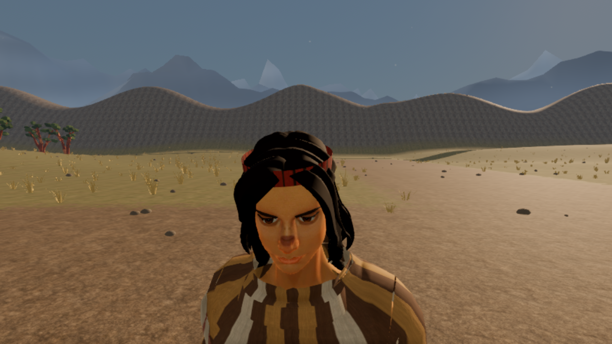
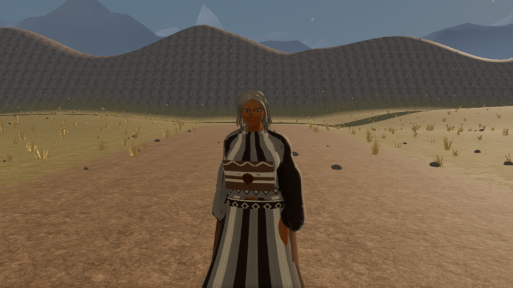
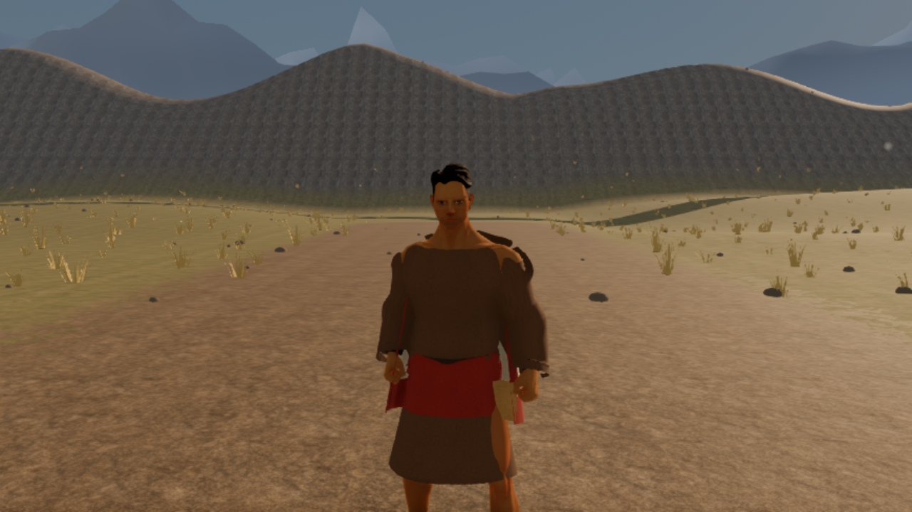
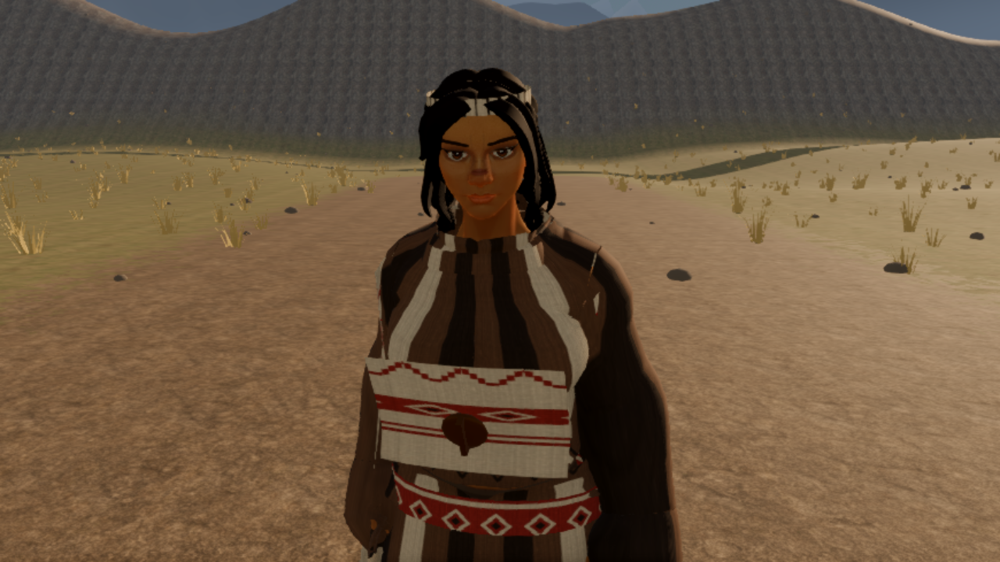
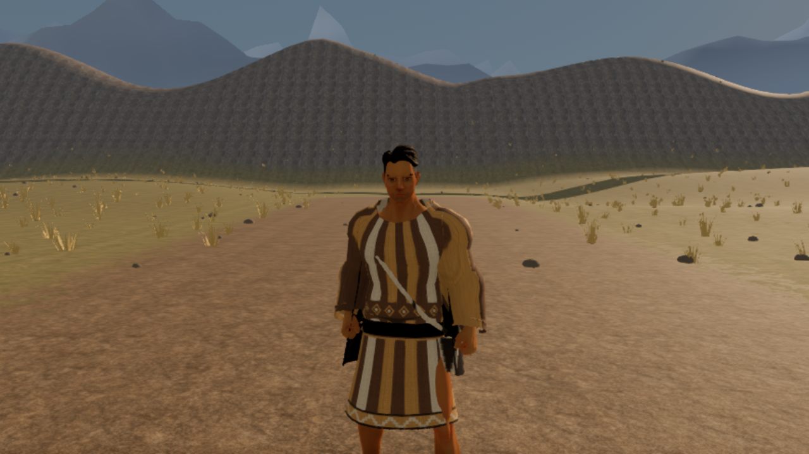
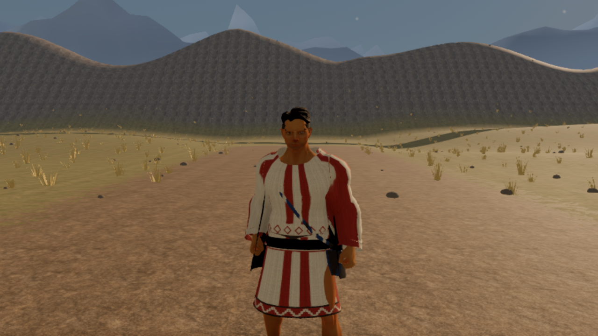
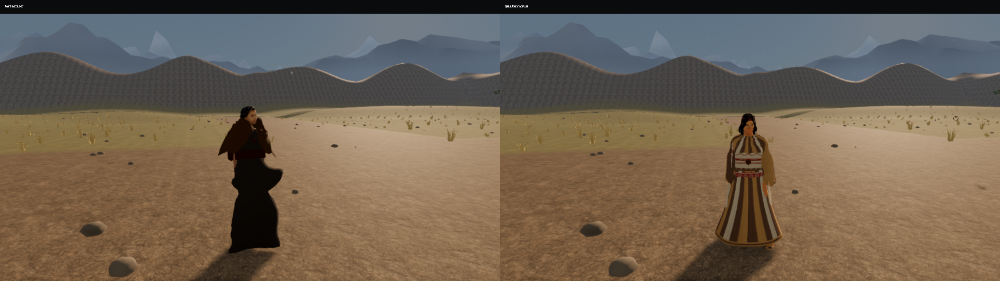
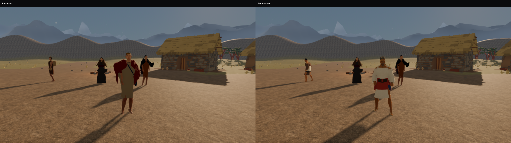
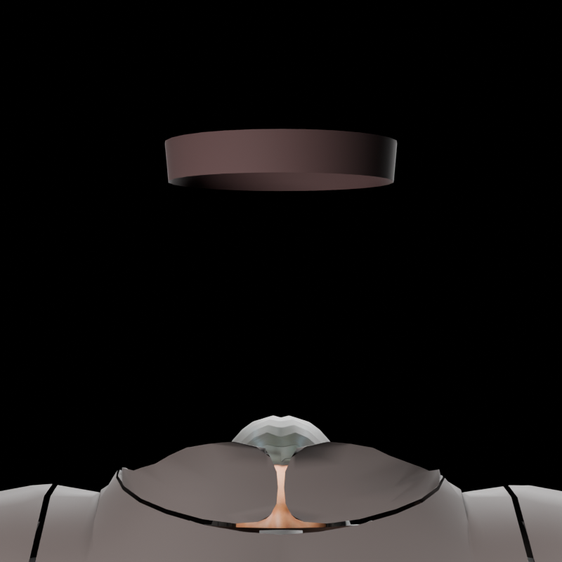
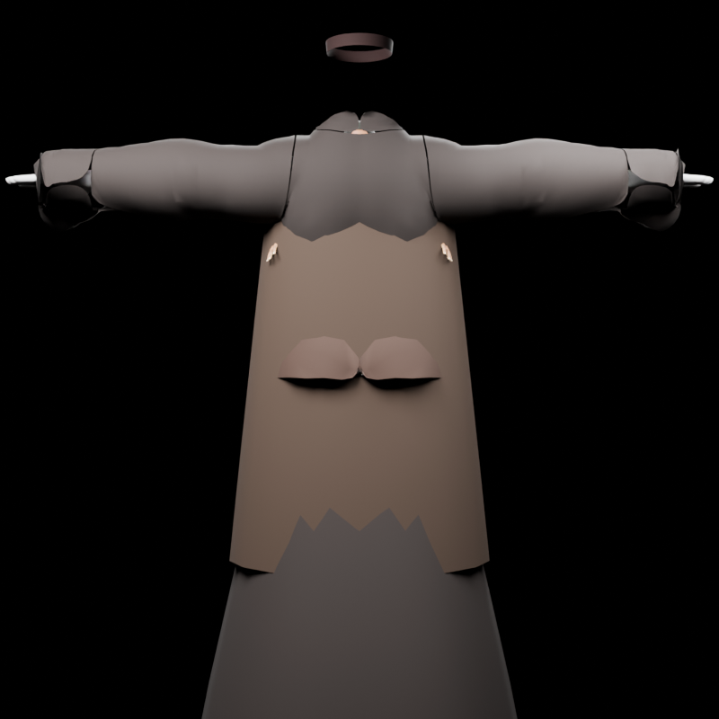

# Personajes Quaternius — prototipo visual

**Estado:** prototipo funcional · 2026-11-17 · Fase 4.9.
**Manda:** [docs/09](../../../docs/09_biblia_narrativa.md) en lo narrativo,
[docs/07](../../../docs/07_convenciones_historicas.md) en lo histórico y la
[guía visual](guia_visual.md) en lo visual.

## 1. Qué se hizo

Se sustituyen **cuatro personajes** por una base Quaternius, sin tocar el
elenco anterior:

| Papel | Modelo | Escena | Qué prueba |
|---|---|---|---|
| Mensajero | `pch_npc_mensajero_q.glb` | Llacta y campamento | Hombre adulto, ropa de viaje, chuspa |
| Sisa (`Habitante3`) | `pch_npc_sisa_q.glb` | Llacta | Mujer joven, anacu, lliclla, trenzas, habla |
| Curaca | `pch_npc_curaca_q.glb` | Llacta y Cusco | Autoridad, t’oqapu, manto, edad |
| Chanca | `pch_npc_chanca_q.glb` | Paso | Combate, porra, impacto, muerte |
| Mujer mayor | `pch_npc_anciana_q.glb` | Multitud del Cusco | Arquetipo andino, canas, trenzas, anacu y lliclla |
| Hombre joven | `pch_npc_joven_q.glb` | Multitud del Cusco | Arquetipo andino, unku sencillo y chuspa |
| Madre (`Habitante1`) | `pch_npc_madre_q.glb` | Llacta | Mujer adulta, anacu, lliclla y paño de cabeza |
| Hermano (`Habitante2`) | `pch_npc_hermano_q.glb` | Llacta | Joven, unku, manto y chuspa |
| Puma (`Principal2`) | `pch_npc_puma_q.glb` | Llacta y asamblea | Autoridad comunal, manto y chuspa, sin t’oqapu |
| Anca (`Anca`) | `pch_npc_anca_q.glb` | Llacta (actos IV–V) | Mujer adulta, anacu, lliclla y tupu |

El resto del elenco sigue con los modelos MakeHuman/Rocketbox. El set se
activa con una bandera, no con un reemplazo masivo:

```bash
godot --path . -- --visual-set=quaternius
```

El valor por defecto es el elenco anterior. El catálogo vive en
`CharacterCatalog` y la librería de clips en `QuaterniusClips`.

## 2. Assets y licencias

- **Cuerpo, cara, ojos, manos y peinados:** Universal Base Characters
  (Standard gratuito), Quaternius, CC0 1.0. ZIP de 122 MB descargado el
  2026-11-16. Solo se usan los dos cuerpos del estándar y cuatro peinados.
- **Texturas de rostro:** derivadas de las albedo 2048 de UBC (CC0) con
  `tools/build_face_textures.py`. El tono, los labios, las ojeras, las líneas
  de edad y el grano de piel se hornean por personaje. Son reconstrucción (R):
  no hay retratos ni tonos documentados.
- **Clips:** UAL1, Quaternius, CC0 1.0, ya versionado en
  `shared_assets/characters/mannequin/ual1_standard.glb`.
- **Ropa, trenzas, cintas, faja, chuspa, tupu y sandalias:** autoría propia,
  generadas por `pch_quaternius.py`.
- **No usado:** la versión Source de pago de Universal Base Characters y el
  Ultimate Animated Character Pack (2019, sin glTF ni rig compartido).
- El detalle está en
  [shared_assets/characters/quaternius/LICENSE.md](../../../shared_assets/characters/quaternius/LICENSE.md).

## 3. Rig y rendimiento

- **65 huesos**, los mismos de UAL1/UAL2. `QuaterniusClips` combina UAL1
  (`idle`, `walk`, `run`, `talk`, `attack`, `death`) con 11 clips de UAL2:
  `idle_b`, `work` y `hit` vienen de UAL2; el resto de UAL1.
- Los GLB salen **sin animaciones**; `QuaterniusClips` copia los clips una vez
  y los añade al `AnimationPlayer` de cada personaje.
- **19,5 k triángulos** por personaje; 5–7 mallas; **GLB de 1,4–2,1 MB**.
- Los GLB **embeben el atlas textil de la ropa** (768×1024 por personaje): es
  lo que da las franjas, rombos y cenefas. Las texturas de cuerpo, cara, pelo y
  ojos **no** se embeben: `QuaterniusMaterials` las carga una sola vez y
  comparte materiales:
  - piel por personaje, 1024 px, con normal y rugosidad de 1024 px:
    `pch.body_sisa`, `pch.body_curaca`, `pch.body_mensajero`, `pch.body_chanca`,
    `pch.body_anciana`, `pch.body_joven`, `pch.body_madre`, `pch.body_hermano`,
    `pch.body_puma` y `pch.body_anca`;
  - cejas propias, más suaves que el pelo: `pch.brow_dark_<m|f>` y
    `pch.brow_grey_<m|f>`;
  - pelo `pch.hair_dark/grey_<m|f>`, ojos `pch.eye` y ropa `pch_cloth`.
  Las texturas de piel se importan con compresión VRAM y mipmaps: el set
  completo suma ~2 MB de vídeo frente a la pasada anterior.
- **Re-proporcionado:** cada cuerpo se estrecha en X y se le da una cabeza
  distinta (ancho, profundidad y mandíbula) antes de hornear la escala. No hay
  nodos con escala: el GLB pasa `AssetValidation`.
- **Piel:** el tono va horneado en la textura de cada personaje (Sisa más
  clara, Mensajero medio, Curaca y Chanca oscuros); ya no se multiplica una
  albedo clara por un tinte que aplastaba el contraste.
- **Cara:** los diez comparten la topología UBC, pero cambian mandíbula,
  pómulos, nariz (más ancha), labios (más llenos), cejas (grosor y ángulo),
  ojeras y líneas de edad. El pliegue epicántico se pinta en la textura y la
  sombra de ojos se suavizó. El Curaca y la mujer mayor suman mejillas
  hundidas y papada; Sisa y el joven, cejas más finas y labios llenos. La base
  sigue siendo UBC: no hay blendshapes ni sincronía labial.
- **Textiles:** túnica de cuello alto con abertura estrecha, franjas
  verticales, lliclla/manto con cenefas, rombos y zigzag, faja con rombos,
  tupu de cobre con disco y alfiler, y chuspa con correa cruzada. El textil se
  pinta por personaje (reconstrucción R sobre PCH-017/018); no es una copia de
  una pieza concreta.
- **Rasgos andinos (R):** pómulos anchos, nariz recta y algo ancha, labios
  llenos, pelo negro liso y piel media/oscura. La mujer mayor lleva canas,
  trenzas, anacu y lliclla; el joven, unku sencillo, faja y chuspa. La familia
  de Rumi —madre, hermano, Puma y Anca— comparte esos criterios con ropa y
  edades distintas; Puma lleva manto y chuspa sin las insignias del curaca. No
  son retratos ni una reconstrucción antropológica: son personajes estilizados
  sobre UBC.
- Orientación: frente hacia −Z, pies en el suelo, sin escala de nodo; el
  `ModelSlot.fit_height` sigue ajustando la altura de cada papel.

Última pasada con los textiles y el tupu (carga 14,4; no es una medición limpia):

| Escena | Set | FPS medio | Draw calls | Memoria de vídeo |
|---|---|---|---|---|
| Llacta | Quaternius | 84,1 | 310 | 225 MB |
| Cusco | anterior | — | 328 | 225 MB |
| Cusco | Quaternius | 61,0 | 349 | 245 MB |

`StaticMeshBatch` fusiona la estática. El Cusco queda en **349 draw calls** y la
llacta en **310**; el Cusco está **a un draw call del presupuesto de 350**. El
set Quaternius cuesta **+21 draw calls** frente al anterior (349 frente a 328)
por los textiles, el tupu y las mallas extra. La memoria sube ~20 MB: los
atlas textiles de la ropa y las texturas de cara. Los FPS se midieron con carga
14,4 y mucha varianza (61,0 en el Cusco): falta repetir la medición en un
equipo descargado. Solo **3 de los 10 puestos** de la multitud usan Quaternius
(mensajero + mujer mayor + joven); el resto sigue con el elenco anterior. El
margen del Cusco ya no admite más personajes sin LOD o sin reducir estática.

## 4. Dirección artística

La identidad no viene del cuerpo de Quaternius, sino de la ropa, el pelo y la
paleta:

| Grupo | Prendas | Paleta | Pelo/tocado |
|---|---|---|---|
| Comunidad, hombre | Unku, manto, chuspa, ojotas | Lana marrón/crema, franjas oscuras | Corto, cinta o paño |
| Comunidad, mujer | Anacu, lliclla con tupu, faja, ojotas | Marrón/gris, rojo y ocre | Largo, trenzas, cinta |
| Autoridad | Unku crema, franja de t’oqapu, manto teñido, cinta | Crema, rojo, azul, ocre | Canas, barba, cinta |
| Chanca | Unku oscuro, manto, porra | Marrón/gris + teal `#296B85` | Recogido, cinta |

- **Documentado (A/R):** unku, anacu, lliclla, manto, chuspa, ojotas, tupu,
  cintas, honda, porra y escudo; sin metal. PCH-017, PCH-018 y PCH-024.
- **Reconstrucción (R):** corte, colores, combinaciones, peinados, caras,
  proporciones y la franja de t’oqapu en una autoridad local anterior a la
  expansión.
- **Ficción (N):** los personajes concretos y la patrulla chanca.
- **Los rostros UBC no son retratos andinos.** Son una base estilizada; la
  lectura histórica la construyen las capas.

## 5. Capturas

| Personaje | Captura |
|---|---|
| Sisa |  |
| Sisa de cerca |  |
| Rostro de Sisa |  |
| Curaca |  |
| Curaca de cerca |  |
| Mensajero |  |
| Chanca |  |
| Mujer mayor |  |
| Mujer mayor de cerca |  |
| Hombre joven |  |
| Hombre joven de cerca |  |
| Mujer mayor en la multitud del Cusco |  |
| Madre |  |
| Madre de cerca |  |
| Hermano |  |
| Hermano de cerca |  |
| Puma |  |
| Puma de cerca |  |
| Anca |  |
| Anca de cerca |  |
| Mano en primera persona |  |

Comparación con el elenco anterior:

| Sisa | Curaca |
|---|---|
|  |  |

| Mensajero | Chanca |
|---|---|
|  |  |

Generación:

```bash
godot --path . --resolution 1280x720 res://tests/scenes/capture_quaternius.tscn \
    -- --visual-set=quaternius
godot --path . --resolution 1280x720 res://tests/scenes/capture_quaternius.tscn
```

El primer comando escribe `user://quaternius_*.png`; el segundo,
`user://legacy_*.png`.

## 6. Qué funciona y qué falta

**Funciona:** altura, orientación, idle, caminar, correr, hablar, combate del
chanca, impacto, muerte, porra en `hand_r`, foco de diálogo, mirada de cabeza,
colisión de escena, catálogo legacy/Quaternius, arena y arco completo.

**Falta:**

- Los cuerpos se estrecharon y las cabezas varían, pero siguen siendo atléticos
  bajo la ropa. El estándar no trae cuerpos regular/teen; el Source de pago no
  se usa.
- Las diez caras comparten la topología base. La textura de 1024, la nariz
  más ancha, los labios más llenos y el pliegue epicántico las acercan, pero
  siguen siendo caras UBC estilizadas; si no alcanza, el siguiente paso es una
  base facial con más rango (MakeHuman u otra) o esculpir la UBC. La familia de
  la llacta ya usa el set; el resto de la multitud sigue con el elenco anterior.
- **HijoPuma** sigue con el elenco anterior: el estándar gratuito de UBC solo
  trae cuerpos adultos y escalar uno a 1,35 m daría un adulto bajito, no un
  niño. Queda pendiente una base infantil.
- El pelo, la barba y las cejas son mallas UBC con textura compartida; a
  distancia se leen bien, de cerca siguen siendo geométricos.
- Mano en primera persona: se sustituyó el bloqueo por una malla propia
  (antebrazo, palma, cuatro dedos de tres falanges, pulgar, manga y bocamanga)
  que usa el mismo tween de interacción. No tiene animación por dedo ni
  articulación; las poses son globales. El recorte de la mano UBC se descartó
  porque deformaba el antebrazo.
- Expresiones faciales y labios: UBC no trae blendshapes; el juego ya usa
  gestos de cuerpo y cabeza. No hay sincronía labial.
- Muelles de manto: la ropa nueva se pesa al torso, no a cadenas `Cape_*`; el
  manto no se mece como el anterior.
- Multitud del Cusco: solo tres puestos usan Quaternius; el resto no se
  sustituye hasta cerrar la estática y la medición.
- El Cusco está en 349/350: cualquier personaje o prop nuevo lo pasa. El
  siguiente paso es LOD/reducir estática antes de migrar el resto de la
  multitud. La memoria sube ~20 MB por los atlas textiles y las texturas de
  cara; si molesta, se pueden comprimir más o compartir atlases.

## 6.1 Prototipo de cabeza MakeHuman (no integrado)

La ropa ya lee andina, pero la cara UBC sigue siendo el techo. Se probó un
injerto de cabeza MakeHuman (MPFB2) sobre el cuerpo de Sisa. El pipeline
funciona en Blender 5.3 con `BLENDER_USER_RESOURCES` de 5.2, pero el primer
resultado **no es utilizable**: la cabeza queda pequeña y hundida en el cuello,
el paño de cabeza flota y la piel sale pálida. El banco de pruebas es
`assets/blender/pch_mh_head_proto.py`; **no se integra en el juego**.

| Injerto fallido | Cuerpo completo |
|---|---|
|  |  |

Antes de repetirlo hay que resolver la escala evaluada del cuerpo MakeHuman, el
parentado al hueso `Head`, los pesos del cuello y el material de piel. Si el
injerto no convence, la alternativa es un **cuerpo MakeHuman completo** con los
textiles nuevos o esculpir la UBC. La decisión queda abierta.

## 7. Pruebas

```bash
godot --headless --path . --import
godot --headless --path . --script res://tests/run_tests.gd
godot --headless --path . --script res://tests/combat_arena_check.gd
godot --headless --path . --script res://tests/arc_playthrough.gd -- --visual-set=quaternius
python3 tools/check_gdscript_limits.py
```

Resultados de la entrega: **131 pruebas, 0 fallos**; arena con el set anterior
y con el set Quaternius (`resolved=3`, `max_attackers=1`); `ARCO_OK` con el set
Quaternius; importación sin errores ni advertencias de `res://`. Las pruebas
recorren los diez modelos y las diez texturas de cara.

Las pruebas nuevas son `test_quaternius_characters.gd` (altura, base, ausencia
de colisión, 65 huesos, `Head`/`hand_r`, materiales y clips, incluidos `idle_b`,
`work` y `hit` de UAL2; texturas de cara de 1024, piel con rugosidad y cejas
propias) y `test_first_person_hands.gd` (malla de la mano y gesto de
interacción).

## 8. Recomendación

El prototipo **sí mejora** la cara, las manos y la silueta percibida: Sisa deja
de ser una silueta oscura y el curaca gana un rostro y una lectura de edad. La
ropa es más simple que la anterior y el cuerpo sigue siendo heroico; por eso
**no conviene sustituir el elenco completo todavía**.

Siguiente lote, en este orden:

1. Decidir el LOD o la reducción de la multitud del Cusco: 349/350 no admite
   más personajes.
2. Decidir la cara: mantener la UBC con estos ajustes o cambiar a una base con
   más rango andino (MakeHuman u otra).
3. Añadir articulación o poses por dedo a la mano en primera persona.
4. Medición limpia y validaciones humanas.
