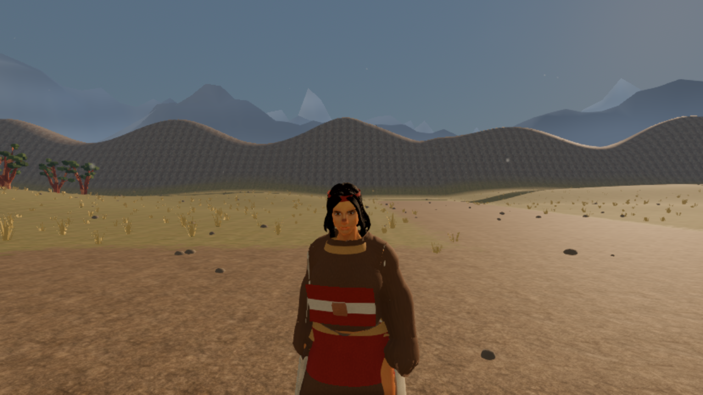
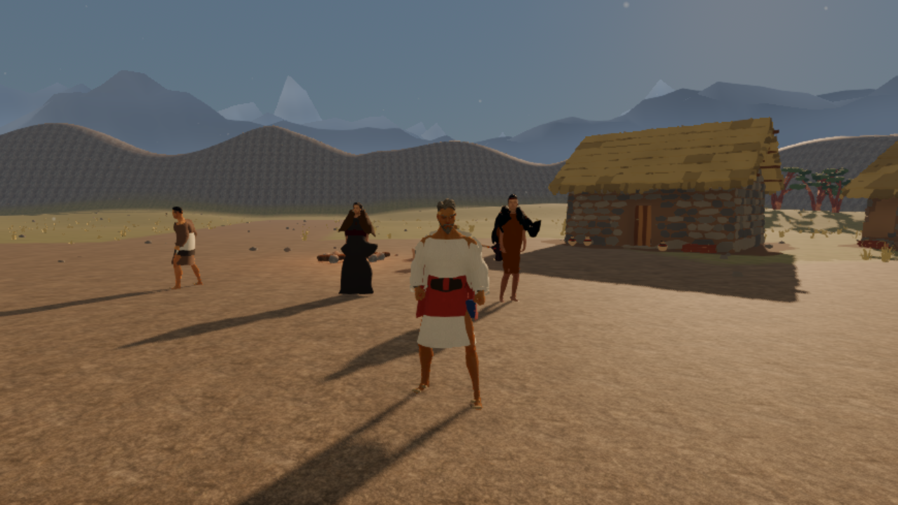
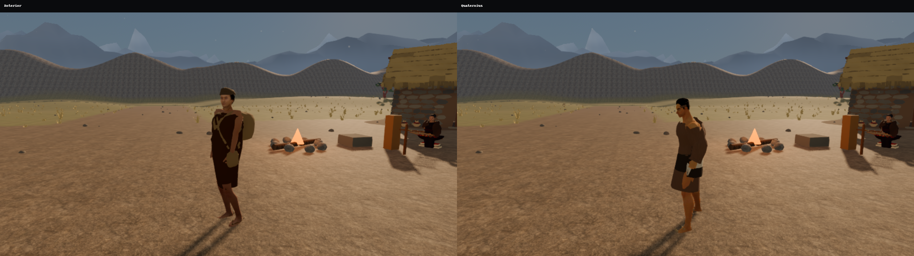
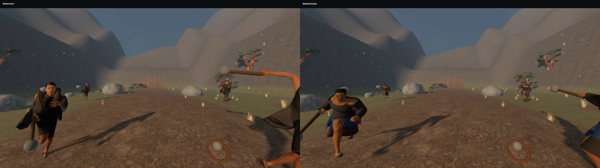

# Personajes Quaternius — prototipo visual

**Estado:** prototipo funcional · 2026-11-17 · Fase 4.9.
**Manda:** [docs/09](../../../docs/09_biblia_narrativa.md) en lo narrativo,
[docs/07](../../../docs/07_convenciones_historicas.md) en lo histórico y la
[guía visual](guia_visual.md) en lo visual.

## 1. Qué se hizo

Se sustituyen **cuatro personajes** por una base Quaternius, sin tocar el
elenco anterior:

| Papel | Modelo | Escena | Qué prueba |
|---|---|---|---|
| Mensajero | `pch_npc_mensajero_q.glb` | Llacta y campamento | Hombre adulto, ropa de viaje, chuspa |
| Sisa (`Habitante3`) | `pch_npc_sisa_q.glb` | Llacta | Mujer joven, anacu, lliclla, trenzas, habla |
| Curaca | `pch_npc_curaca_q.glb` | Llacta y Cusco | Autoridad, t’oqapu, manto, edad |
| Chanca | `pch_npc_chanca_q.glb` | Paso | Combate, porra, impacto, muerte |

El resto del elenco sigue con los modelos MakeHuman/Rocketbox. El set se
activa con una bandera, no con un reemplazo masivo:

```bash
godot --path . -- --visual-set=quaternius
```

El valor por defecto es el elenco anterior. El catálogo vive en
`CharacterCatalog` y la librería de clips en `QuaterniusClips`.

## 2. Assets y licencias

- **Cuerpo, cara, ojos, manos y peinados:** Universal Base Characters
  (Standard gratuito), Quaternius, CC0 1.0. ZIP de 122 MB descargado el
  2026-11-16. Solo se usan los dos cuerpos del estándar y cuatro peinados.
- **Texturas de rostro:** derivadas de las albedo 2048 de UBC (CC0) con
  `tools/build_face_textures.py`. El tono, los labios, las ojeras, las líneas
  de edad y el grano de piel se hornean por personaje. Son reconstrucción (R):
  no hay retratos ni tonos documentados.
- **Clips:** UAL1, Quaternius, CC0 1.0, ya versionado en
  `shared_assets/characters/mannequin/ual1_standard.glb`.
- **Ropa, trenzas, cintas, faja, chuspa, tupu y sandalias:** autoría propia,
  generadas por `pch_quaternius.py`.
- **No usado:** la versión Source de pago de Universal Base Characters y el
  Ultimate Animated Character Pack (2019, sin glTF ni rig compartido).
- El detalle está en
  [shared_assets/characters/quaternius/LICENSE.md](../../../shared_assets/characters/quaternius/LICENSE.md).

## 3. Rig y rendimiento

- **65 huesos**, los mismos de UAL1/UAL2. `QuaterniusClips` combina UAL1
  (`idle`, `walk`, `run`, `talk`, `attack`, `death`) con 11 clips de UAL2:
  `idle_b`, `work` y `hit` vienen de UAL2; el resto de UAL1.
- Los GLB salen **sin animaciones**; `QuaterniusClips` copia los clips una vez
  y los añade al `AnimationPlayer` de cada personaje.
- **19,5 k triángulos** por personaje; 5–6 mallas; **GLB de 1–1,6 MB**.
- Los GLB **no embeben texturas**. `QuaterniusMaterials` (separado de
  `SurfaceMaterials`) carga una sola vez las texturas y comparte materiales:
  - piel por personaje, 1024 px, con normal y rugosidad de 1024 px:
    `pch.body_sisa`, `pch.body_curaca`, `pch.body_mensajero`, `pch.body_chanca`;
  - cejas propias, más suaves que el pelo: `pch.brow_dark_<m|f>` y
    `pch.brow_grey_<m|f>`;
  - pelo `pch.hair_dark/grey_<m|f>`, ojos `pch.eye` y ropa `pch_cloth`.
  Las texturas de piel se importan con compresión VRAM y mipmaps: el set
  completo suma ~2 MB de vídeo frente a la pasada anterior.
- **Re-proporcionado:** cada cuerpo se estrecha en X y se le da una cabeza
  distinta (ancho, profundidad y mandíbula) antes de hornear la escala. No hay
  nodos con escala: el GLB pasa `AssetValidation`.
- **Piel:** el tono va horneado en la textura de cada personaje (Sisa más
  clara, Mensajero medio, Curaca y Chanca oscuros); ya no se multiplica una
  albedo clara por un tinte que aplastaba el contraste.
- **Cara:** las cuatro comparten la topología UBC, pero cambian mandíbula,
  pómulos, nariz, cejas (grosor y ángulo), labios, ojeras y líneas de edad. El
  Curaca suma mejillas hundidas y papada; Sisa, cejas más finas y labios llenos.
  No hay blendshapes ni sincronía labial.
- Orientación: frente hacia −Z, pies en el suelo, sin escala de nodo; el
  `ModelSlot.fit_height` sigue ajustando la altura de cada papel.

Última pasada con las caras nuevas (carga 9,5, equipo ocupado; no es una
medición limpia):

| Escena | Set | FPS medio | Draw calls | Memoria de vídeo |
|---|---|---|---|---|
| Llacta | Quaternius | 111,0 | 341 | 214 MB |
| Cusco | Quaternius | 71,7 | 492 | 204 MB |

La pasada anterior, con carga 3,5–3,9, dio 114,8 FPS en la llacta y 73,1 en el
Cusco. Las caras añaden ~2 MB de vídeo gracias a la compresión VRAM; el coste
en draw calls no cambia (**+5** en la llacta y **+8** en el Cusco). La variación
entre sesiones sigue siendo alta: falta repetir la medición en un equipo
descargado. Aun así, el set completo —multitud incluida— no cabe en el
presupuesto de 350 draw calls: no se sustituye la multitud del Cusco.

## 4. Dirección artística

La identidad no viene del cuerpo de Quaternius, sino de la ropa, el pelo y la
paleta:

| Grupo | Prendas | Paleta | Pelo/tocado |
|---|---|---|---|
| Comunidad, hombre | Unku, manto, chuspa, ojotas | Lana marrón/crema, franjas oscuras | Corto, cinta o paño |
| Comunidad, mujer | Anacu, lliclla con tupu, faja, ojotas | Marrón/gris, rojo y ocre | Largo, trenzas, cinta |
| Autoridad | Unku crema, franja de t’oqapu, manto teñido, cinta | Crema, rojo, azul, ocre | Canas, barba, cinta |
| Chanca | Unku oscuro, manto, porra | Marrón/gris + teal `#296B85` | Recogido, cinta |

- **Documentado (A/R):** unku, anacu, lliclla, manto, chuspa, ojotas, tupu,
  cintas, honda, porra y escudo; sin metal. PCH-017, PCH-018 y PCH-024.
- **Reconstrucción (R):** corte, colores, combinaciones, peinados, caras,
  proporciones y la franja de t’oqapu en una autoridad local anterior a la
  expansión.
- **Ficción (N):** los personajes concretos y la patrulla chanca.
- **Los rostros UBC no son retratos andinos.** Son una base estilizada; la
  lectura histórica la construyen las capas.

## 5. Capturas

| Personaje | Captura |
|---|---|
| Sisa |  |
| Sisa de cerca |  |
| Rostro de Sisa |  |
| Curaca |  |
| Curaca de cerca |  |
| Mensajero |  |
| Chanca |  |
| Mano en primera persona |  |

Comparación con el elenco anterior:

| Sisa | Curaca |
|---|---|
|  |  |

| Mensajero | Chanca |
|---|---|
|  |  |

Generación:

```bash
godot --path . --resolution 1280x720 res://tests/scenes/capture_quaternius.tscn \
    -- --visual-set=quaternius
godot --path . --resolution 1280x720 res://tests/scenes/capture_quaternius.tscn
```

El primer comando escribe `user://quaternius_*.png`; el segundo,
`user://legacy_*.png`.

## 6. Qué funciona y qué falta

**Funciona:** altura, orientación, idle, caminar, correr, hablar, combate del
chanca, impacto, muerte, porra en `hand_r`, foco de diálogo, mirada de cabeza,
colisión de escena, catálogo legacy/Quaternius, arena y arco completo.

**Falta:**

- Los cuerpos se estrecharon y las cabezas varían, pero siguen siendo atléticos
  bajo la ropa. El estándar no trae cuerpos regular/teen; el Source de pago no
  se usa.
- Las cuatro caras comparten la topología base. La textura de 1024 y los
  ajustes de mandíbula, pómulos, nariz, cejas, labios y edad ya las separan,
  pero no hay caras esculpidas ni blendshapes. Faltan dos arquetipos para la
  multitud: mujer mayor y hombre joven.
- El pelo, la barba y las cejas son mallas UBC con textura compartida; a
  distancia se leen bien, de cerca siguen siendo geométricos.
- Mano en primera persona: se sustituyó el bloqueo por una malla propia
  (antebrazo, palma, cuatro dedos de tres falanges, pulgar, manga y bocamanga)
  que usa el mismo tween de interacción. No tiene animación por dedo ni
  articulación; las poses son globales. El recorte de la mano UBC se descartó
  porque deformaba el antebrazo.
- Expresiones faciales y labios: UBC no trae blendshapes; el juego ya usa
  gestos de cuerpo y cabeza. No hay sincronía labial.
- Muelles de manto: la ropa nueva se pesa al torso, no a cadenas `Cape_*`; el
  manto no se mece como el anterior.
- Multitud del Cusco y el resto del elenco: no se sustituyen hasta cerrar la
  medición y las variantes de cara.
- El Cusco sigue por encima del presupuesto de 350 draw calls; la solución
  pasa por LOD/multitud o por dejar la multitud con el elenco anterior.

## 7. Pruebas

```bash
godot --headless --path . --import
godot --headless --path . --script res://tests/run_tests.gd
godot --headless --path . --script res://tests/combat_arena_check.gd
godot --headless --path . --script res://tests/arc_playthrough.gd -- --visual-set=quaternius
python3 tools/check_gdscript_limits.py
```

Resultados de la entrega: **131 pruebas, 0 fallos**; arena con el set anterior
y con el set Quaternius (`resolved=3`, `max_attackers=1`); `ARCO_OK` con el set
Quaternius; importación sin errores ni advertencias de `res://`.

Las pruebas nuevas son `test_quaternius_characters.gd` (altura, base, ausencia
de colisión, 65 huesos, `Head`/`hand_r`, materiales y clips, incluidos `idle_b`,
`work` y `hit` de UAL2; texturas de cara de 1024, piel con rugosidad y cejas
propias) y `test_first_person_hands.gd` (malla de la mano y gesto de
interacción).

## 8. Recomendación

El prototipo **sí mejora** la cara, las manos y la silueta percibida: Sisa deja
de ser una silueta oscura y el curaca gana un rostro y una lectura de edad. La
ropa es más simple que la anterior y el cuerpo sigue siendo heroico; por eso
**no conviene sustituir el elenco completo todavía**.

Siguiente lote, en este orden:

1. Añadir dos arquetipos de multitud: mujer mayor y hombre joven.
2. Cerrar la medición del Cusco y decidir la multitud.
3. Añadir articulación o poses por dedo a la mano en primera persona.
4. Solo entonces, migrar el resto del elenco.
