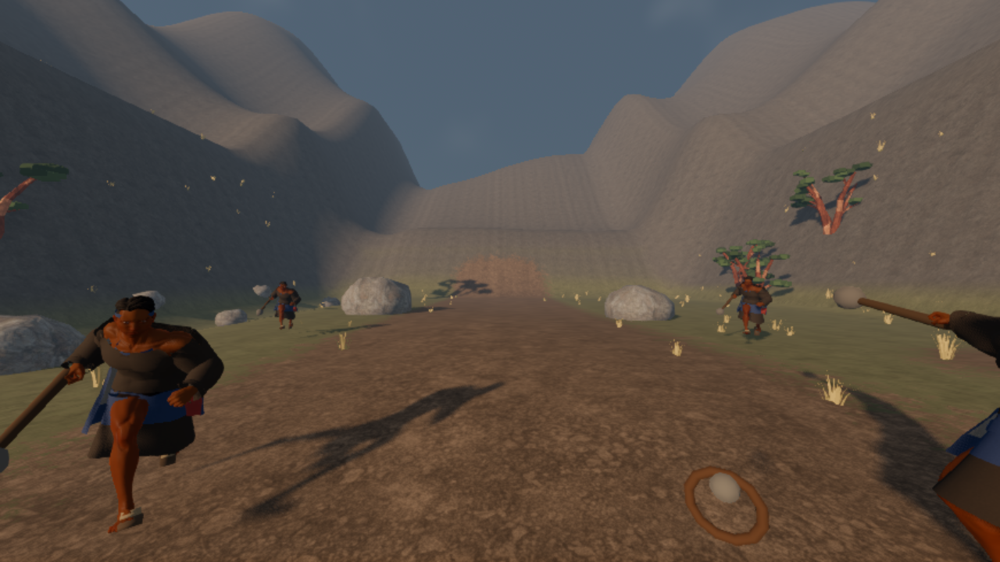

# Personajes Quaternius — prototipo visual

**Estado:** prototipo funcional · 2026-11-16 · Fase 4.9.
**Manda:** [docs/09](../../../docs/09_biblia_narrativa.md) en lo narrativo,
[docs/07](../../../docs/07_convenciones_historicas.md) en lo histórico y la
[guía visual](guia_visual.md) en lo visual.

## 1. Qué se hizo

Se sustituyen **cuatro personajes** por una base Quaternius, sin tocar el
elenco anterior:

| Papel | Modelo | Escena | Qué prueba |
|---|---|---|---|
| Mensajero | `pch_npc_mensajero_q.glb` | Llacta y campamento | Hombre adulto, ropa de viaje, chuspa |
| Sisa (`Habitante3`) | `pch_npc_sisa_q.glb` | Llacta | Mujer joven, anacu, lliclla, trenzas, habla |
| Curaca | `pch_npc_curaca_q.glb` | Llacta y Cusco | Autoridad, t’oqapu, manto, edad |
| Chanca | `pch_npc_chanca_q.glb` | Paso | Combate, porra, impacto, muerte |

El resto del elenco sigue con los modelos MakeHuman/Rocketbox. El set se
activa con una bandera, no con un reemplazo masivo:

```bash
godot --path . -- --visual-set=quaternius
```

El valor por defecto es el elenco anterior. El catálogo vive en
`CharacterCatalog` y la librería de clips en `QuaterniusClips`.

## 2. Assets y licencias

- **Cuerpo, cara, ojos, manos y peinados:** Universal Base Characters
  (Standard gratuito), Quaternius, CC0 1.0. ZIP de 122 MB descargado el
  2026-11-16. Solo se usan los dos cuerpos del estándar y cuatro peinados.
- **Clips:** UAL1, Quaternius, CC0 1.0, ya versionado en
  `shared_assets/characters/mannequin/ual1_standard.glb`.
- **Ropa, trenzas, cintas, faja, chuspa, tupu y sandalias:** autoría propia,
  generadas por `pch_quaternius.py`.
- **No usado:** la versión Source de pago de Universal Base Characters y el
  Ultimate Animated Character Pack (2019, sin glTF ni rig compartido).
- El detalle está en
  [shared_assets/characters/quaternius/LICENSE.md](../../../shared_assets/characters/quaternius/LICENSE.md).

## 3. Rig y rendimiento

- **65 huesos**, los mismos de UAL1/UAL2. El prototipo usa UAL1: `idle`,
  `idle_b`, `walk`, `run`, `talk`, `work`, `weave`, `tired`, `attack`, `hit`
  y `death`.
- Los GLB salen **sin animaciones**; `QuaterniusClips` copia los clips una vez
  y los añade al `AnimationPlayer` de cada personaje.
- **19,5 k triángulos** por personaje; 5–6 mallas; texturas de 512 px (ojos de
  256 px); materiales `pch.body_light/mid/dark`, `pch.hair`, `pch.hair_grey`,
  `pch.eye` y `pch_cloth`.
- **Re-proporcionado:** cada cuerpo se estrecha en X y se le da una cabeza
  distinta (ancho, profundidad y mandíbula) antes de hornear la escala. No hay
  nodos con escala: el GLB pasa `AssetValidation`.
- **Piel:** tres tintes (`light`, `mid`, `dark`) para que el elenco no comparta
  el mismo tono. Sisa usa `light`, Mensajero `mid`, Curaca y Chanca `dark`.
- Orientación: frente hacia −Z, pies en el suelo, sin escala de nodo; el
  `ModelSlot.fit_height` sigue ajustando la altura de cada papel.

Última pasada local con carga 1,2–1,4, misma sesión para ambos sets:

| Escena | Set | FPS medio | Draw calls | Memoria de vídeo |
|---|---|---|---|---|
| Llacta | anterior | 105,4 | 336 | 195 MB |
| Llacta | Quaternius | 98,3 | 341 | 209 MB |
| Cusco | anterior | 65,1 | 481 | 211 MB |
| Cusco | Quaternius | 71,6 | 491 | 203 MB |

El coste es de **+5 draw calls** en la llacta y **+10** en el Cusco. La llacta
pierde ~7 FPS; el Cusco se movió entre 65 y 72 FPS según la pasada, siempre por
encima de 60. La variación entre sesiones es alta (pasadas anteriores dieron
117,6/77,4): hay que repetir la medición en un equipo descargado antes de
cerrar el set completo. Las texturas de 512 px hacen que el Cusco no gane
memoria. Aun así, el set completo —multitud incluida— no cabe en el
presupuesto de 350 draw calls: no se sustituye la multitud del Cusco.

## 4. Dirección artística

La identidad no viene del cuerpo de Quaternius, sino de la ropa, el pelo y la
paleta:

| Grupo | Prendas | Paleta | Pelo/tocado |
|---|---|---|---|
| Comunidad, hombre | Unku, manto, chuspa, ojotas | Lana marrón/crema, franjas oscuras | Corto, cinta o paño |
| Comunidad, mujer | Anacu, lliclla con tupu, faja, ojotas | Marrón/gris, rojo y ocre | Largo, trenzas, cinta |
| Autoridad | Unku crema, franja de t’oqapu, manto teñido, cinta | Crema, rojo, azul, ocre | Canas, barba, cinta |
| Chanca | Unku oscuro, manto, porra | Marrón/gris + teal `#296B85` | Recogido, cinta |

- **Documentado (A/R):** unku, anacu, lliclla, manto, chuspa, ojotas, tupu,
  cintas, honda, porra y escudo; sin metal. PCH-017, PCH-018 y PCH-024.
- **Reconstrucción (R):** corte, colores, combinaciones, peinados, caras,
  proporciones y la franja de t’oqapu en una autoridad local anterior a la
  expansión.
- **Ficción (N):** los personajes concretos y la patrulla chanca.
- **Los rostros UBC no son retratos andinos.** Son una base estilizada; la
  lectura histórica la construyen las capas.

## 5. Capturas

| Personaje | Captura |
|---|---|
| Sisa |  |
| Rostro de Sisa |  |
| Curaca |  |
| Mensajero |  |
| Chanca |  |

Comparación con el elenco anterior:

| Sisa | Curaca |
|---|---|
|  |  |

| Mensajero | Chanca |
|---|---|
|  |  |

Generación:

```bash
godot --path . --resolution 1280x720 res://tests/scenes/capture_quaternius.tscn \
    -- --visual-set=quaternius
godot --path . --resolution 1280x720 res://tests/scenes/capture_quaternius.tscn
```

El primer comando escribe `user://quaternius_*.png`; el segundo,
`user://legacy_*.png`.

## 6. Qué funciona y qué falta

**Funciona:** altura, orientación, idle, caminar, correr, hablar, combate del
chanca, impacto, muerte, porra en `hand_r`, foco de diálogo, mirada de cabeza,
colisión de escena, catálogo legacy/Quaternius, arena y arco completo.

**Falta:**

- Los cuerpos se estrecharon y las cabezas varían, pero siguen siendo atléticos
  bajo la ropa. El estándar no trae cuerpos regular/teen; el Source de pago no
  se usa.
- Las cuatro caras comparten la topología base. Hay variación de cráneo,
  mandíbula, pómulos y piel, pero faltan arrugas, narices y bocas esculpidas
  para que el elenco no se lea como variantes del mismo rostro.
- Manos y antebrazos en primera persona: el jugador sigue viendo el bloqueo
  anterior. Se intentó un recorte estático de la mano UBC, pero el encuadre y
  la deformación del antebrazo no pasaron la prueba; se descartó y no se
  versiona. Queda pendiente un viewmodel dedicado.
- Expresiones faciales y labios: UBC no trae blendshapes; el juego ya usa
  gestos de cuerpo y cabeza. No hay sincronía labial.
- Muelles de manto: la ropa nueva se pesa al torso, no a cadenas `Cape_*`; el
  manto no se mece como el anterior.
- UAL2: se verificó su compatibilidad de 65 huesos, pero no se integró; el
  prototipo usa UAL1.
- Multitud del Cusco y el resto del elenco: no se sustituyen hasta cerrar la
  medición y las variantes de cara.
- Texturas compartidas: cada GLB embebe sus texturas. Para el elenco completo
  hay que pasar a una carpeta común o a materiales compartidos.

## 7. Pruebas

```bash
godot --headless --path . --import
godot --headless --path . --script res://tests/run_tests.gd
godot --headless --path . --script res://tests/combat_arena_check.gd
godot --headless --path . --script res://tests/arc_playthrough.gd -- --visual-set=quaternius
python3 tools/check_gdscript_limits.py
```

Resultados de la entrega: **129 pruebas, 0 fallos**; arena con el set anterior
y con el set Quaternius (`resolved=3`, `max_attackers=1`); `ARCO_OK` con el set
Quaternius; importación sin errores ni advertencias de `res://`.

Las pruebas nuevas son `test_quaternius_characters.gd`: validan altura, base,
ausencia de colisión, 65 huesos, `Head`/`hand_r`, materiales, clips y el
`NpcActor` con un cuerpo Quaternius.

## 8. Recomendación

El prototipo **sí mejora** la cara, las manos y la silueta percibida: Sisa deja
de ser una silueta oscura y el curaca gana un rostro y una lectura de edad. La
ropa es más simple que la anterior y el cuerpo sigue siendo heroico; por eso
**no conviene sustituir el elenco completo todavía**.

Siguiente lote, en este orden:

1. Cerrar la variación de caras con arrugas, nariz y boca; el cráneo y la piel
   ya varían.
2. Compartir texturas y cerrar la medición del Cusco.
3. Integrar UAL2 para combate y oficios.
4. Resolver manos en primera persona.
5. Solo entonces, migrar el resto del elenco.
