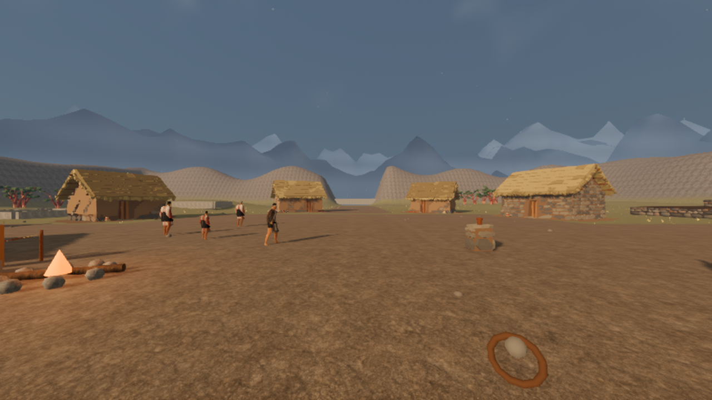
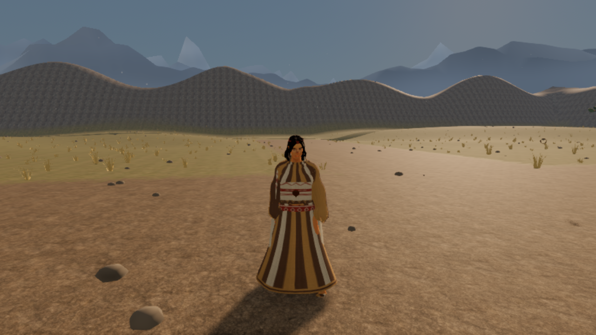
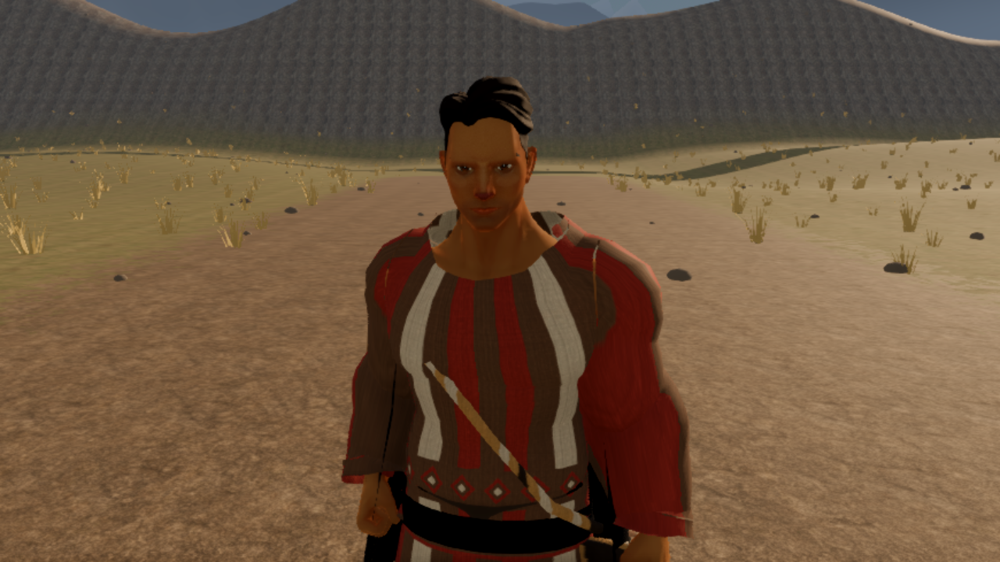
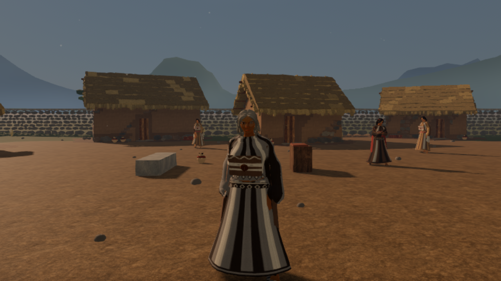
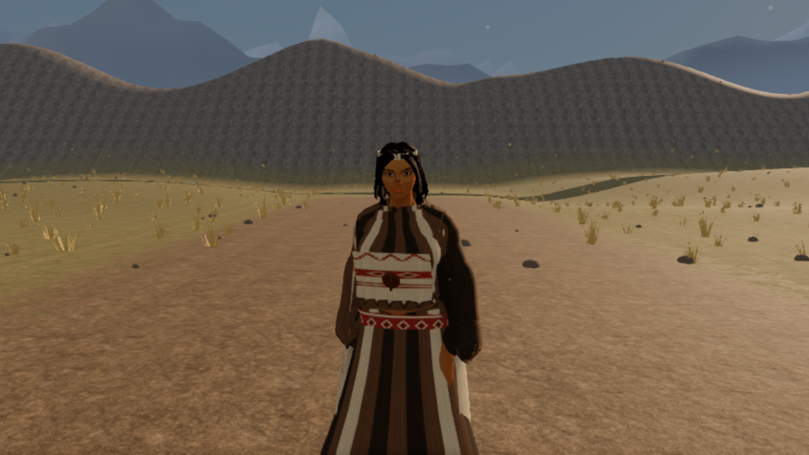
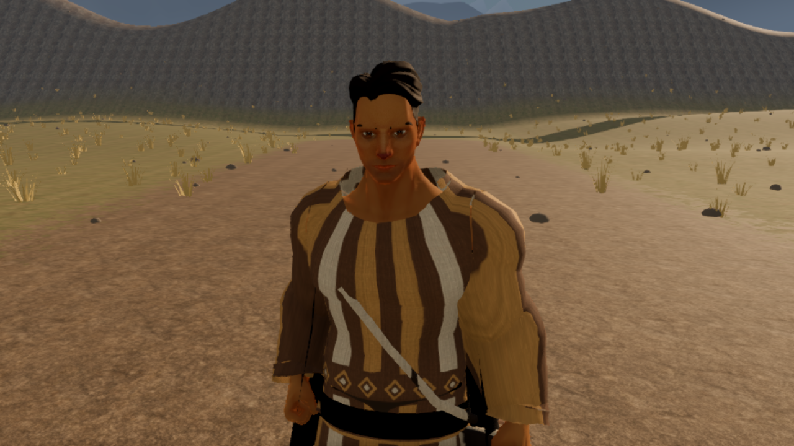
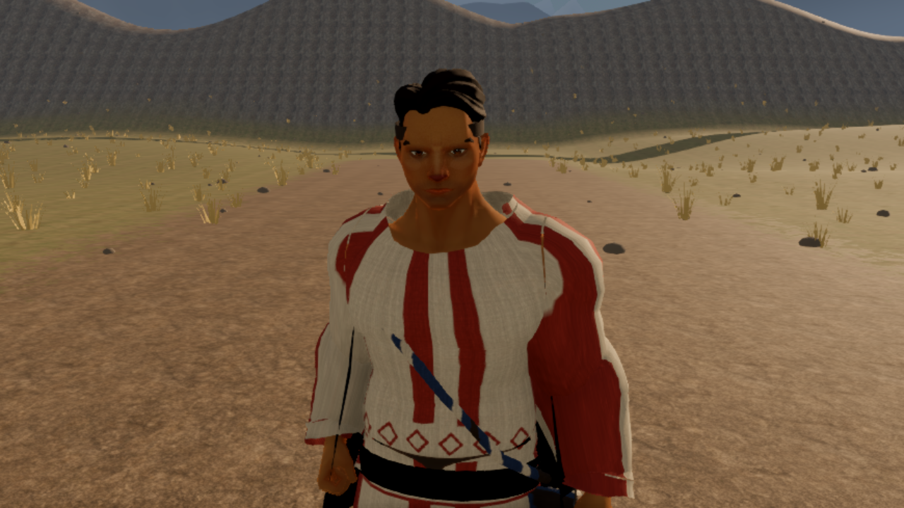
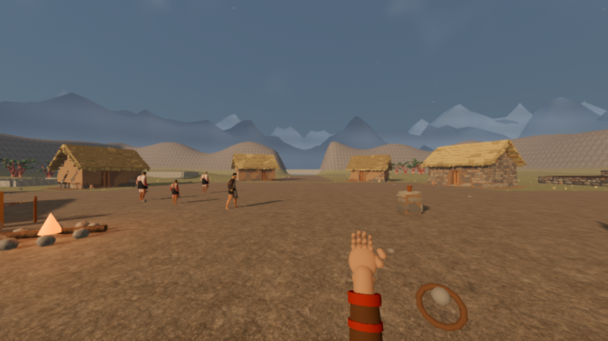

# Personajes Quaternius — elenco único

**Estado:** elenco único · 2026-11-17 · Fase 4.12.
**Manda:** [docs/09](../../../docs/09_biblia_narrativa.md) en lo narrativo,
[docs/07](../../../docs/07_convenciones_historicas.md) en lo histórico y la
[guía visual](guia_visual.md) en lo visual.

## 1. Qué es

Todo el elenco de la campaña usa el set **Quaternius** de Universal Base
Characters (UBC, CC0). No hay set anterior, ni bandera de selección, ni modo
híbrido: una partida normal carga los diez GLB Q. Los papeles que no tienen un
modelo propio reutilizan un arquetipo; el catálogo está en
`CharacterCatalog` y los clips en `QuaterniusClips`.

| Papel | Modelo Q | Nota |
|---|---|---|
| Tejedora | Anca Q | Clip `weave`; el telar sigue en la escena |
| Agricultor | Joven Q | Clip `work`; falta la chaquitaclla como prop |
| Curaca / CuracaVecino | Curaca Q | Autoridad, t’oqapu y manto |
| Principal2 / `principal` | Puma Q | Autoridad comunal, sin t’oqapu |
| Habitante1 / Habitante2 / Habitante3 | Madre / Hermano / Sisa Q | Familia de Rumi |
| Anca | Anca Q | Anacu, lliclla y tupu |
| Mensajero / `messenger` | Mensajero Q | Ropa de viaje y chuspa |
| HijoPuma | Joven Q | Escalado a 1,20 m; no hay base infantil |
| Herido1 / Herido2 | Hermano / Madre Q | Clip `tired` |
| Comitiva1 / 2 / 3 | Madre / Hermano / Joven Q | Actos IV–V |
| `curaca`, `farmer`, `weaver`, `villager` del Cusco y el Paso | Curaca / Joven / Anca / arquetipos Q | La multitud rota entre los diez Q |

El cuerpo, la ropa, la cara, el pelo y los clips son los mismos que ya estaban
probados en el prototipo. La diferencia es que ahora **no queda nada del
elenco MakeHuman/Rocketbox** en el juego: se borraron sus GLB, sus capturas y
la documentación del híbrido.

## 2. Assets y licencias

- **Cuerpo, cara, ojos, manos y peinados:** Universal Base Characters
  (Standard gratuito), Quaternius, CC0 1.0.
- **Texturas de rostro:** derivadas de las albedo 2048 de UBC (CC0) con
  `tools/build_face_textures.py`. Tono, labios, ojeras, líneas de edad y grano
  por personaje; reconstrucción (R), no retratos.
- **Clips:** UAL1 y UAL2, Quaternius, CC0 1.0.
- **Ropa, trenzas, cintas, faja, chuspa, tupu y sandalias:** autoría propia,
  generadas por `pch_quaternius.py`.
- **No usado:** la versión Source de pago de UBC y el Ultimate Animated
  Character Pack.
- El detalle está en
  [shared_assets/characters/quaternius/LICENSE.md](../../../shared_assets/characters/quaternius/LICENSE.md).

## 3. Rig y rendimiento

- **65 huesos**, los mismos de UAL1/UAL2. `QuaterniusClips` combina UAL1
  (`idle`, `walk`, `run`, `talk`, `attack`, `death`) con 11 clips de UAL2;
  `idle_b`, `work` y `hit` vienen de UAL2.
- Los GLB salen **sin animaciones**; `QuaterniusClips` copia los clips una vez
  y los añade al `AnimationPlayer` de cada personaje.
- **19,5 k triángulos** por personaje; 5–7 mallas; **GLB de 1,4–2,1 MB**.
- Los GLB **embeben el atlas textil de la ropa** (768×1024 por personaje); las
  texturas de cuerpo, cara, pelo y ojos se cargan una vez desde
  `QuaterniusMaterials`.
- **LOD de multitud:** las figuras del Cusco ocultan el tupu por material
  (`crowd` en `CharacterModelVisual`); conservan cuerpo, ropa, pelo, ojos y
  cejas. Las cejas se conservan porque sin ellas la cara parece vacía y su
  coste es mínimo una vez que no proyectan sombra.
- **Política de sombras:** solo cuerpo y ropa proyectan sombra. Ojos, cejas,
  tupu y pelo no: cada superficie suma un draw call por split del sol y no
  aporta a la silueta. La sombra del cuerpo sigue apoyando las figuras.
- **HijoPuma** es el joven Q a 1,20 m: se lee como un adulto pequeño, no como
  un niño. Es la limitación consciente de no usar una base infantil.

### Medición del elenco completo

Medición con el set Q completo, sin bandera. Tres pasadas por acto con carga
4,3–6,9; se publica la mediana:

| Acto | Draw calls | Memoria de vídeo | FPS medio | p1 |
|---|---|---|---|---|
| I — Llacta | 248 | 222,2 MB | 84,1 | 79,7 |
| II — Paso | 244 | 162,8 MB | 106,2 | 100,0 |
| III — Cusco | 288 | 230,8 MB | 62,6 | 60,0 |
| IV — Posguerra | 226 | 222,8 MB | 91,9 | 85,7 |
| V — Obra | 257 | 217,4 MB | 89,5 | 85,7 |

Los cinco actos cumplen el presupuesto de **≤ 350 draw calls**. Son tres pasadas
por acto con carga 4,3–6,9 y se publica la mediana. El desglose del Cusco mostró
que la multitud pesaba 173 draw calls y el pase de sombra 266; el LOD por
material y la política de sombras los dejan en torno a 100 y 140. El Cusco es el acto
más ajustado (62,6 FPS de media, p1 60,0); en la peor pasada el p1 bajó a 54,8,
así que falta confirmarlo en un equipo completamente descargado. No se vuelve al
elenco anterior: la decisión es Q único.

## 4. Dirección artística

La identidad viene de la ropa, el pelo, la paleta y la silueta:

| Grupo | Prendas | Paleta | Pelo/tocado |
|---|---|---|---|
| Comunidad, hombre | Unku, manto, chuspa, ojotas | Lana marrón/crema, franjas oscuras | Corto, cinta o paño |
| Comunidad, mujer | Anacu, lliclla con tupu, faja, ojotas | Marrón/gris, rojo y ocre | Largo, trenzas, cinta |
| Autoridad | Unku crema, franja de t’oqapu, manto teñido, cinta | Crema, rojo, azul, ocre | Canas, barba, cinta |
| Chanca | Unku oscuro, manto, porra | Marrón/gris + teal `#296B85` | Recogido, cinta |

- **Documentado (A/R):** unku, anacu, lliclla, manto, chuspa, ojotas, tupu,
  cintas, honda, porra y escudo; sin metal. PCH-017, PCH-018 y PCH-024.
- **Reconstrucción (R):** corte, colores, combinaciones, peinados, caras,
  proporciones y la franja de t’oqapu.
- **Ficción (N):** los personajes concretos y la patrulla chanca.
- **Los rostros UBC no son retratos andinos.** Son una base estilizada; la
  lectura histórica la construyen las capas. No hay más intentos de cara
  realista: la cara Quaternius es la definitiva.

## 5. Capturas

| Personaje | Captura |
|---|---|
| Llacta completa |  |
| Sisa |  |
| Sisa de cerca |  |
| Rostro de Sisa |  |
| Curaca |  |
| Curaca de cerca |  |
| Mensajero |  |
| Chanca |  |
| Mujer mayor |  |
| Mujer mayor de cerca |  |
| Hombre joven |  |
| Hombre joven de cerca |  |
| Multitud del Cusco |  |
| Madre |  |
| Madre de cerca |  |
| Hermano |  |
| Hermano de cerca |  |
| Puma |  |
| Puma de cerca |  |
| Anca |  |
| Anca de cerca |  |
| Mano en primera persona |  |

Generación:

```bash
godot --path . --resolution 1280x720 res://tests/scenes/capture_quaternius.tscn
```

Escribe `user://quaternius_*.png`.

## 6. Qué funciona y qué falta

**Funciona:** los diez modelos Q cubren todos los papeles; altura, orientación,
idle, caminar, correr, hablar, trabajo, tejido, combate del chanca, impacto,
muerte, porra en `hand_r`, foco de diálogo, mirada de cabeza, colisión, multitud
Q, política de sombras, arena y arco completo.

**Falta:**

- **FPS del Cusco:** 62,6 de media y p1 60,0 con carga 4,3–6,9; en la peor
  pasada el p1 bajó a 54,8. Falta confirmarlo en un equipo descargado.
- La cara UBC sigue siendo estilizada. Es la cara definitiva del set; si se
  quiere realismo, es una tarea de escultura/arte, no de código.
- **HijoPuma** es un adulto Q escalado, no un niño.
- **Agricultor** reutiliza el joven Q sin la chaquitaclla; el prop queda
  pendiente. **Tejedora** reutiliza Anca Q con el clip `weave`.
- Heridos y comitiva reutilizan arquetipos; no tienen ropa propia.
- El pelo, la barba y las cejas siguen siendo mallas UBC; a distancia se leen
  bien, de cerca son geométricas.
- Mano en primera persona sin articulación por dedo; sin blendshapes ni
  sincronía labial; el manto no se mece (sin cadenas `Cape_*`).
- Validación humana: movimiento, diálogo, combate y lectura a distancia con el
  elenco completo.

## 7. Pruebas

```bash
godot --headless --path . --import
godot --headless --path . --script res://tests/run_tests.gd
godot --headless --path . --script res://tests/combat_arena_check.gd
godot --headless --path . --script res://tests/arc_playthrough.gd
python3 tools/check_gdscript_limits.py
```

Resultados: **133 pruebas, 0 fallos**; arena (`resolved=3`, `max_attackers=1`)
y `ARCO_OK` con el set Q; importación sin errores ni advertencias de `res://`.
Las pruebas recorren los diez modelos, las diez texturas de cara y el catálogo
de todos los papeles.

Las pruebas del elenco son `test_quaternius_characters.gd` (altura, base,
ausencia de colisión, 65 huesos, `Head`/`hand_r`, materiales y clips, incluidos
`idle_b`, `work` y `hit` de UAL2; texturas de cara de 1024, piel con rugosidad,
cejas propias, catálogo de todos los papeles, política de sombras y LOD de
multitud) y `test_first_person_hands.gd` (malla de la mano y gesto de
interacción).

## 8. Decisión

Quaternius es el **único** set visual. Se retiraron los modelos
MakeHuman/Rocketbox, el híbrido Rocketbox, el injerto de cabeza MakeHuman y sus
pruebas/capturas. No se vuelve atrás. El rendimiento del Cusco está cerrado
(288 draw calls, cinco actos bajo 350); el siguiente trabajo es la chaquitaclla
del Agricultor, la base infantil de HijoPuma y el pulido de manos y expresiones.
