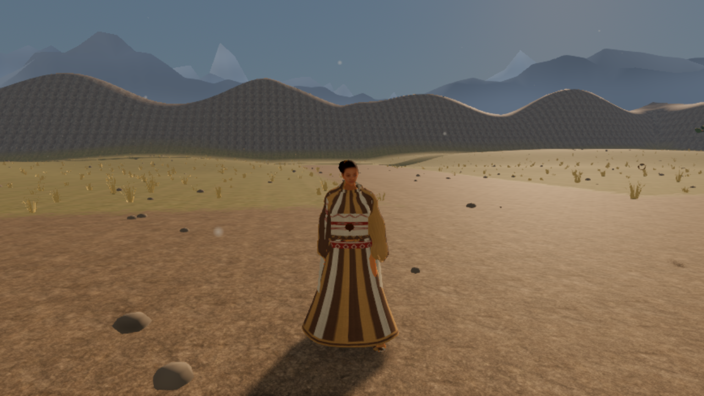
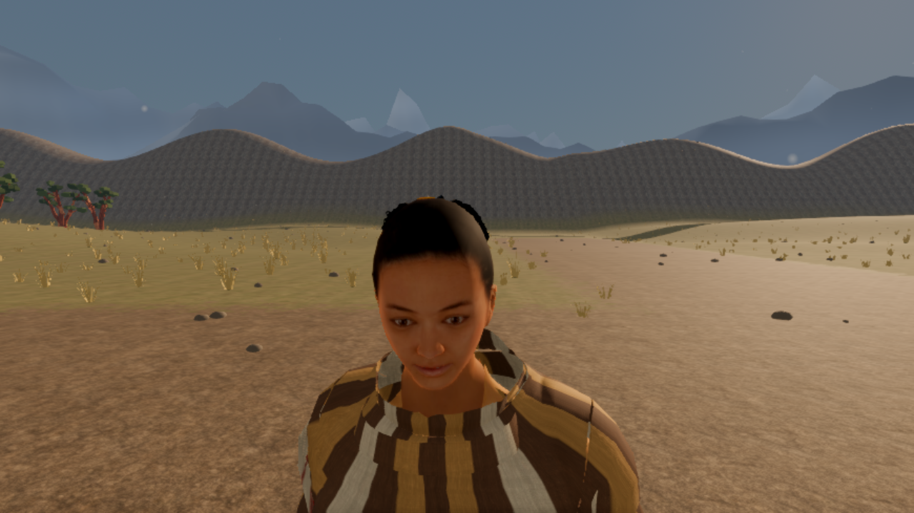
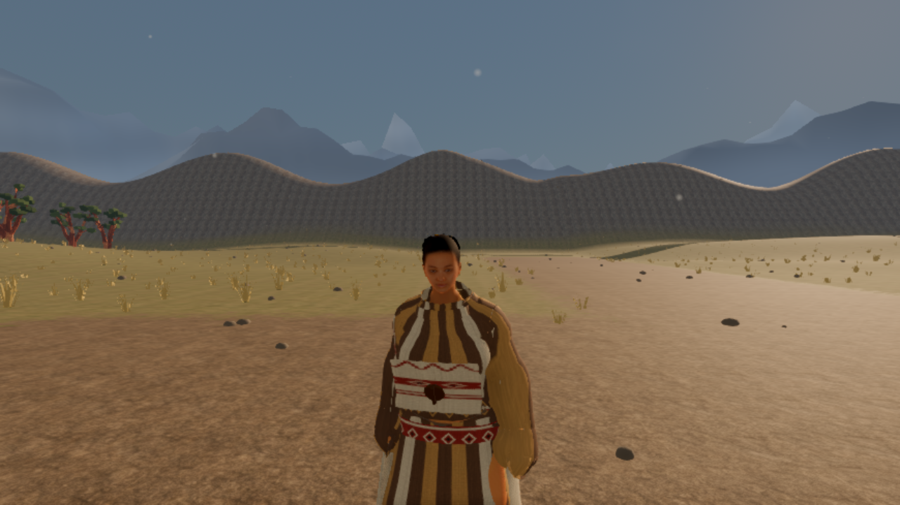
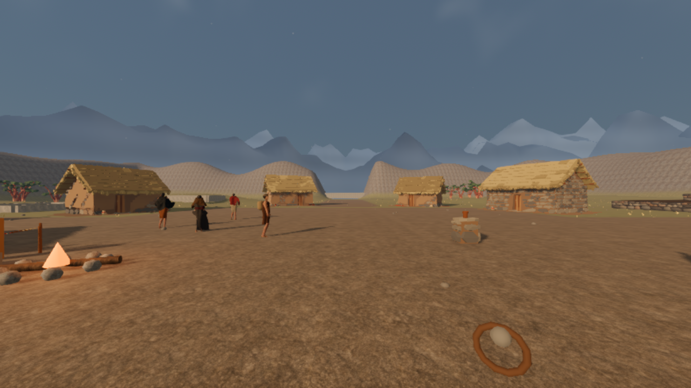

# Personajes Rocketbox — set híbrido (piloto)

**Estado:** piloto funcional · 2026-11-17 · Fase 4.12.
**Manda:** [docs/09](../../../docs/09_biblia_narrativa.md) en lo narrativo,
[docs/07](../../../docs/07_convenciones_historicas.md) en lo histórico y la
[guía visual](guia_visual.md) en lo visual.

## 1. Qué es

El set híbrido conserva **cuerpo, ropa, esqueleto y clips Quaternius** y
sustituye solo la cabeza estilizada UBC, los ojos, las cejas y el pelo por una
**cabeza Rocketbox** realista del elenco anterior. La cabeza queda rígida al
hueso `Head`; `QuaterniusClips` sigue añadiendo los clips UAL1/UAL2 en Godot,
sin retargeting.

El piloto sustituye **solo a Sisa** (`Habitante3`) en la llacta y en el Cusco.
El resto del elenco sigue con su modelo anterior. **El set Quaternius no se
toca**: `--visual-set=quaternius` sigue cargando los `pch_npc_*_q.glb`
originales y una partida normal sigue usando el elenco anterior.

```bash
godot --path . -- --visual-set=rocketbox
# o
PCH_VISUAL_SET=rocketbox godot --path .
```

## 2. Sisa híbrida

- **Cuerpo y ropa:** `pch_npc_sisa_q.glb`, sin cambios: anacu, lliclla, faja,
  tupu, sandalias, esqueleto de 65 huesos y texturas compartidas.
- **Cabeza:** `HeadRB`, una sola malla con la cabeza y el pelo Rocketbox de
  `pch_npc_weaver.glb` (donante femenino joven).
- **Recorte:** el cuerpo Q se corta a 1,54 m; la cabeza tapa el cuello y el
  collar Q oculta la unión.
- **Alineación:** la escala sale de la anchura de la cara en la línea de ojos
  (ojo Q a 1,656 m; ojo Rocketbox estimado a `Head + 0,03`); la nariz alinea
  el frente. Escala final 1,03.
- **Piel:** la textura de la cabeza se lleva al tono de la cara Q con un tinte
  suave del 45 % para no dejar la piel anaranjada; se quita el mapa de
  normales, que marcaba demasiado la cara bajo el sol del juego.
- **Pelo:** se tiñe a negro/marrón oscuro; se retira el pelo, los ojos y las
  cejas Q.
- **Cinta:** se retira la cinta Q porque estaba modelada para el cráneo UBC y
  flotaba sobre la cabeza Rocketbox. Falta una cinta nueva ajustada al cráneo.
- **Materiales:** `SurfaceMaterials` aplica su material de piel a `rb.head` y
  el recorte al pelo; el cuerpo y la ropa siguen usando los materiales Q.

## 3. Rig, clips y rendimiento

- **65 huesos** del rig UBC; la cabeza va al 100 % al hueso `Head`.
- Clips UAL1/UAL2: `idle`, `walk`, `run`, `talk`, `attack`, `hit`, `death` y
  los alternos; se añaden con `QuaterniusClips`, igual que en Quaternius.
- Mallas: cuerpo, ropa, cabeza y tupu (disco + alfiler). La cabeza híbrida
  sustituye tres mallas Q (pelo, ojos y cejas) por una, así que el set debería
  ahorrar draw calls al extenderse.
- **Piloto medido** (el modo solo sustituye a Sisa; el resto del set Q no se
  activa, por eso no es comparable con Quaternius completo):

| Escena | Draw calls | Memoria de vídeo | FPS medio | Carga |
|---|---|---|---|---|
| Llacta | 298 | 223,1 MB | 39,3 | 2,02 |
| Cusco | 328 | 225,2 MB | 38,2 | 2,02–2,16 |

La carga era alta; los FPS no son concluyentes. El Cusco queda por debajo del
presupuesto de 350 draw calls. El set Quaternius completo sigue en 349/245 MB.

## 4. Dirección artística y límites

Las cabezas Rocketbox son **escaneos de personas reales** (Microsoft Rocketbox,
MIT), teñidos. **No son retratos andinos ni una reconstrucción antropológica**;
la identidad andina la siguen construyendo la ropa, el textil, el peinado y la
paleta. La cara es una licencia artística (R/N) y no un documento.

La mezcla de una cara realista con el cuerpo estilizado Q puede caer en
*uncanny valley*. El cuello y el collar la sostienen en el piloto, pero hay que
revisarla en movimiento y a distancia de juego.

## 5. Capturas

| Sisa híbrida | Primer plano |
|---|---|
|  |  |

| Rostro | Llacta |
|---|---|
|  |  |

Generación:

```bash
blender --background --factory-startup \
    --python campaigns/01_pachacutec/assets/blender/pch_rocketbox_heads.py -- \
    --only pch_npc_sisa_rb --preview /tmp/opencode/rocketbox_preview
godot --path . --resolution 1280x720 res://tests/scenes/capture_quaternius.tscn \
    -- --visual-set=rocketbox
```

## 6. Qué funciona y qué falta

**Funciona:** cuerpo y ropa Q intactos, cabeza realista alineada, rig de 65
huesos, clips UAL, diálogo y catálogo `rocketbox`; el set Q sigue disponible.

**Falta:**

- Extender el piloto a los otros nueve papeles; `HijoPuma` seguirá legacy
  porque no hay base infantil Q.
- Cinta/paño de cabeza: la Q no se adapta; hace falta una pieza nueva.
- Tono de piel por papel: el tinte actual es una aproximación; el sol cálido
  del juego oscurece la cara.
- Costura del cuello: el collar la oculta en el piloto, pero hay que revisarla
  en cada cuerpo.
- Medición limpia de FPS y draw calls con el set completo.
- Validación humana: movimiento, diálogo, combate y lectura a distancia.
- Prueba de humo y actualización del arco con el set híbrido completo.

## 7. Licencias

- Cuerpo, esqueleto, ropa y clips: Quaternius Universal Base Characters y
  UAL1/UAL2, CC0 1.0.
- Cabeza y pelo: Microsoft Rocketbox Avatar Library, MIT.
- Texturas de cara Q y atlas textil: generadas en el repositorio.
- El detalle está en
  [assets/models/LICENSE.md](../assets/models/LICENSE.md) y
  [shared_assets/characters/quaternius/LICENSE.md](../../../shared_assets/characters/quaternius/LICENSE.md).
