# Elenco de maniquíes UAL1 y panel de objetivo

> Estado: **diez looks aprobados e integrados en las escenas**. La mano de
> primera persona sigue **pendiente de revisión**: el responsable no está
> conforme con su resultado. El elenco UBC ya no se carga en partida, pero sus
> GLB, caras, pruebas y código de soporte quedan como legado hasta el lote de
> retirada.

## 1. Qué se ha probado

- **Diez maniquíes** con el mismo cuerpo UAL1 de Quaternius y diez looks:
  - **Curaca:** unku crema, franja de t'oqapu roja y ocre, manto rojo, cinta
    ocre y chuspa azul. Sin orejeras, vara, oro ni metales.
  - **Sisa:** anacu pardo con ruedo rojo, lliclla crema con tupu, faja y cinta
    rojas y melena posterior.
  - **Chanca:** unku carbón, faldón pizarra, faja y cinta teal y manto pesado;
    las armas van en el actor de combate.
  - **Anca:** anacu arena y pardo, lliclla ocre con tupu, faja y cinta rojas y
    melena posterior. Es también el look de la Tejedora.
  - **Puma:** unku oliva, manto, faja y cinta ocres y chuspa oscuro; autoridad
    sin t'oqapu.
  - **Madre:** anacu gris, lliclla clara con tupu, paño oscuro y melena.
  - **Hermano:** unku crema, manto pardo, faja roja y chuspa pequeño.
  - **Joven:** unku arena y chuspa clara; es el Agricultor, el HijoPuma a
    1,20 m y el arquetipo de multitud.
  - **Anciana:** anacu gris, lliclla plateada con tupu, paño gris y canas.
  - **Mensajero:** ropa de viaje parda, paño oscuro, chuspa ocre, correa y
    bulto a la espalda.
- **Integración en partida:** la llacta, el Cusco y el paso montan los diez
  looks sobre `NpcActor` y `CharacterModelVisual`. La multitud usa una versión
  reducida del look, el chanca lleva su porra y el mensajero conserva el bulto.
  Los diez papeles aparecen en las escenas reales, no solo en el prototipo.
- **Atuendo fusionado por hueso:** las piezas de un mismo hueso se funden en
  una malla con colores de vértice. El personaje pasa de una decena de piezas a
  tres mallas de ropa (torso, cadera y cabeza) más las dos del cuerpo.
- **Clip lógicos:** el maniquí usa los clips de `QuaterniusClips` con los
  mismos nombres que el elenco anterior; el `work` y el `hit` vienen de UAL2.
- **Mano del jugador** de maniquí: antebrazo extraído del UAL1 y palma, cuatro
  dedos separados y pulgar primitivos, con los colores de piel y juntas. Tiene
  pose abierta para interactuar y puño cerrado para la honda y la porra; ambas
  se hornean en dos mallas (piel y juntas) para no multiplicar draw calls.
  **Queda pendiente de revisión.**
- **Panel de objetivo** arriba a la izquierda, con fondo oscuro y texto cálido,
  integrado en el HUD actual; aprobado tal como está.

Capturas:

| Prototipo | Imagen |
|---|---|
| Cinco papeles principales | 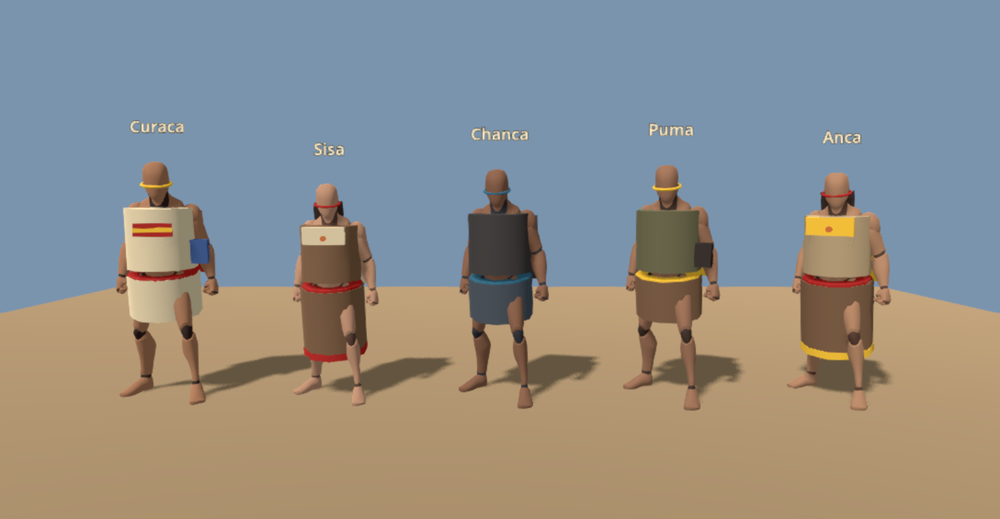 |
| Familia, multitud y mensajero |  |
| Curaca en la llacta | 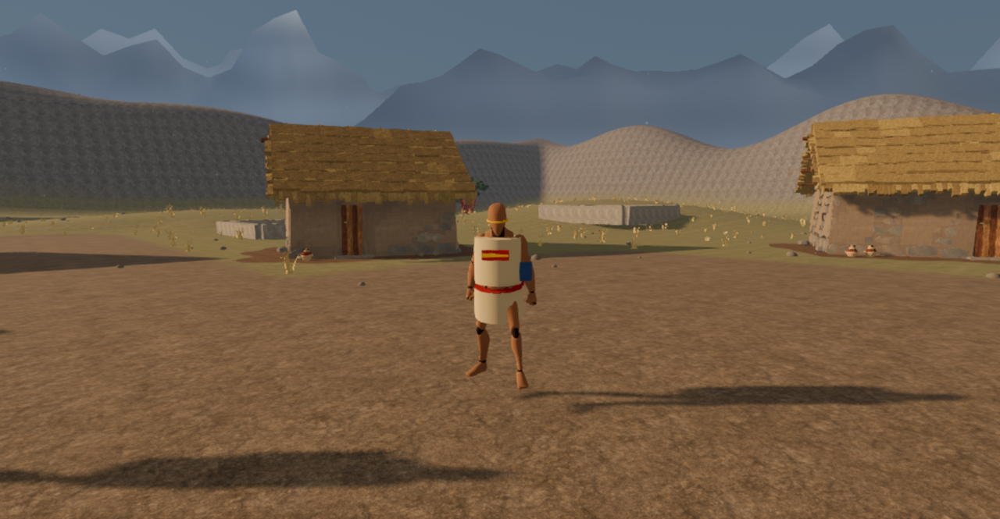 |
| Sisa en la llacta | 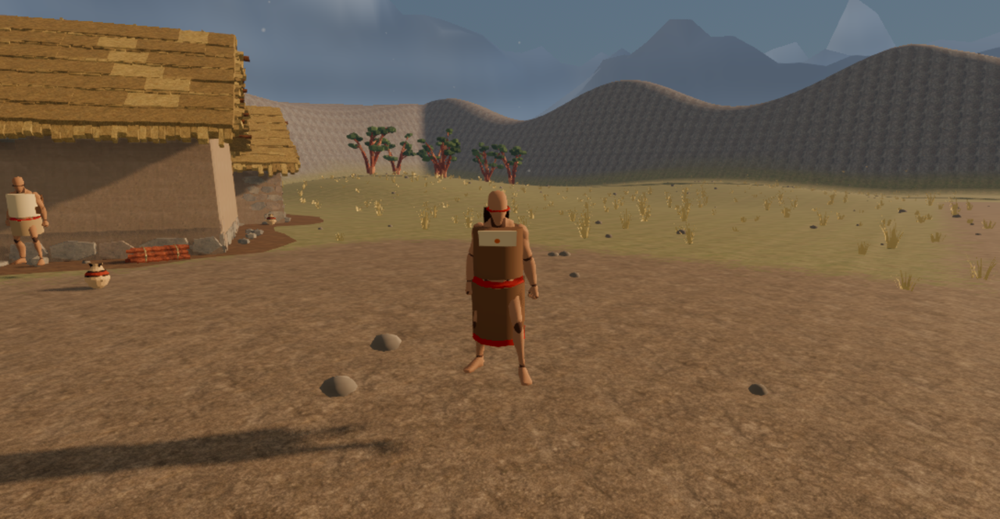 |
| Familia de Rumi | 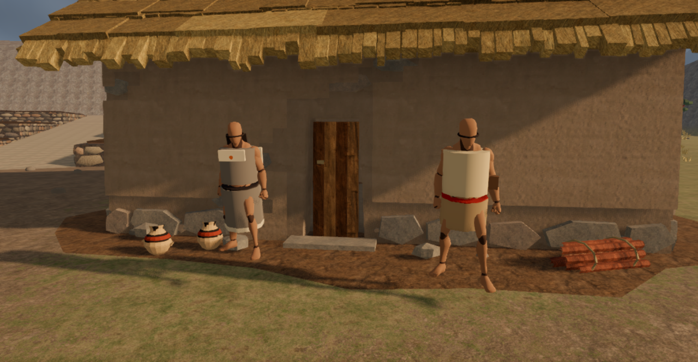 |
| Tejedora trabajando | 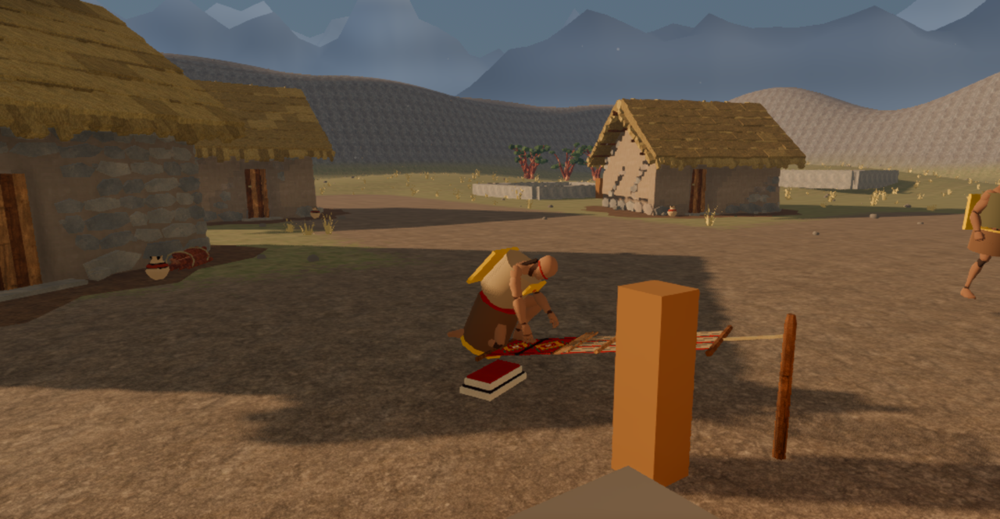 |
| HijoPuma a 1,20 m | 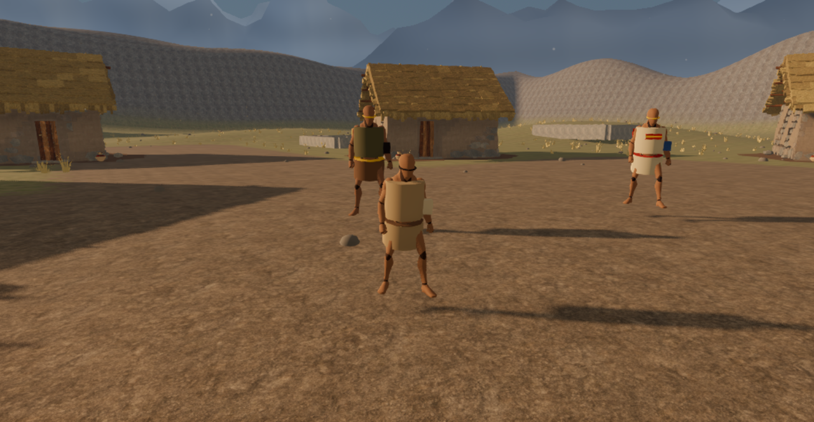 |
| Cusi en el Cusco | 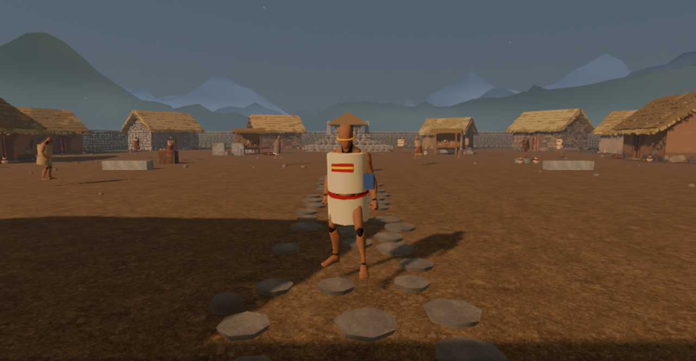 |
| Multitud del Cusco | 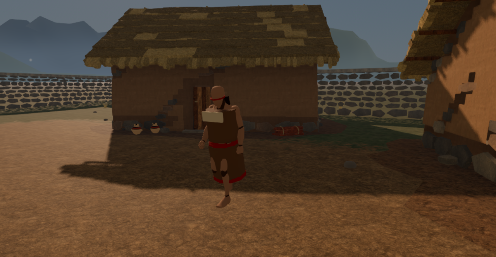 |
| Chanca con porra | 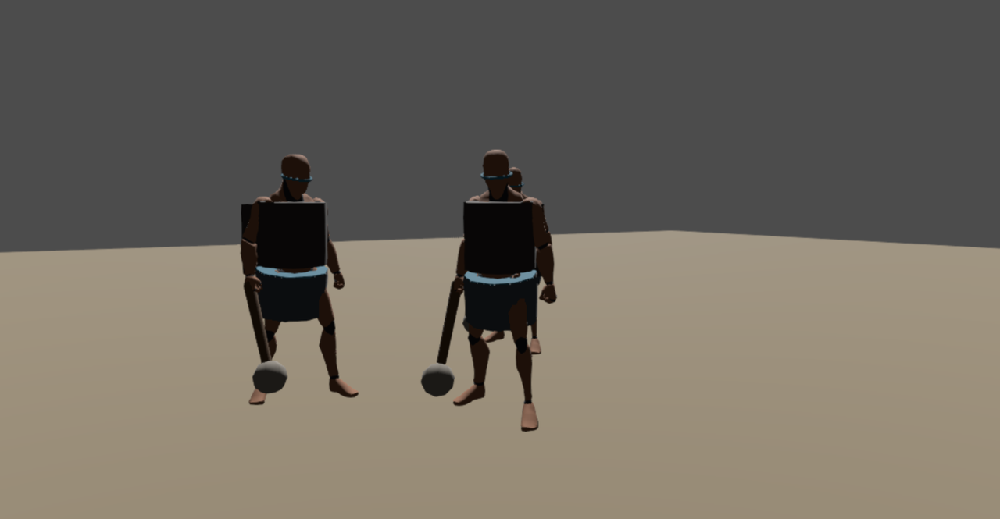 |
| Mano abierta en la llacta | 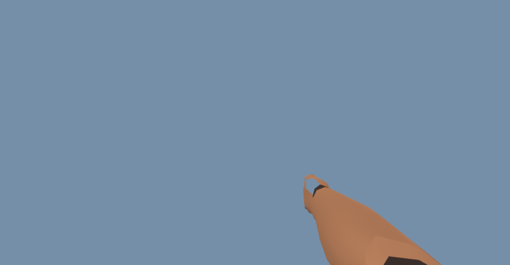 |
| Puño con la honda | 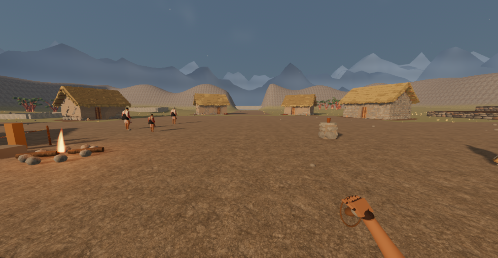 |
| Puño con la porra |  |
| Panel de objetivo en la llacta |  |

## 2. Cómo se ejecuta

```bash
godot --path . res://tests/scenes/mannequin_prototype.tscn
godot --path . res://tests/scenes/mannequin_hand_prototype.tscn
```

La primera guarda `user://maniquies_principales.png` y
`user://maniquies_apoyo.png`; la segunda, `user://mano_abierta.png` y
`user://mano_agarre.png`. El antebrazo se regenera con:

```bash
blender --background --factory-startup --python tools/blender_mannequin_forearm.py
```

Las capturas en partida se tomaron con cámaras de prueba sobre las escenas
reales (llacta, Cusco y arena de combate); no alteran el juego.

## 3. Qué se aprende del proyecto de referencia

`/home/jamaya/Projects/el-despertar-del-sol` usa un solo maniquí UAL1 para todos
los personajes y separa el aspecto en datos:

- `CharacterLook`: color de piel, color de juntas y lista de piezas.
- `LookPart`: caja, cilindro, anillo o disco; hueso, tamaño, offset, giro y color.
- `CharacterOutfit`: aplica las dos superficies del cuerpo y cuelga las piezas
  de huesos con `BoneAttachment3D`.

No hay caras, texturas de piel ni ropa esculpida. La identidad sale de la
silueta, los colores y cuatro o cinco piezas. Es un estilo de maniquí legible y
barato, y elimina los problemas de rostro y tela del elenco UBC.

De la interfaz se adopta el **panel de objetivo contextual**: arriba a la
izquierda, fondo oscuro, texto cálido y legible, con contadores cuando haga
falta. La referencia lo muestra al cambiar de objetivo y durante el combate, y
oculta el resto del HUD fuera de combate. Nuestro prototipo mantiene el panel
visible mientras la tarea está activa y conserva el diario para el detalle.

Otras ideas que merece la pena conservar:

- Pasos de misión como datos (`SliceStep`): objetivo, tipo, marcador, bandera,
  aviso y checkpoint.
- Checkpoint al empezar cada paso.
- HUD mínimo: barras solo cuando hacen falta y objetivo contextual.
- Códex con etiquetas (Documentado / Según los cronistas / Licencia del juego).
- Pruebas separadas de personaje, atuendo y HUD.

## 4. Qué falta

1. ~~Aprobar los diez looks.~~ **Hecho.**
2. ~~Crear los looks de los diez papeles.~~ **Hecho:** viven en
   `MannequinLooks`, con alturas de la tabla de la llacta.
3. ~~Integrar el maniquí en `NpcActor`/`CharacterModelVisual`.~~ **Hecho** en
   llacta, Cusco, paso y chancas.
4. ~~Multitud con LOD.~~ **Hecho:** `MannequinLooks.crowd_from` reduce el look
   a silueta, color y cabeza.
5. ~~Retirar el legado UBC.~~ **Hecho:** se eliminaron los GLB, caras,
   catálogo, `CharacterFace`, `CapeSprings`, `QuaterniusMaterials`, la rama
   UBC de los visuales, sus herramientas y su prueba.
6. ~~Integrar la mano en `FirstPersonHands` y en el arma.~~ **Hecho, pero
   pendiente de revisión:** el resultado actual no convence al responsable.
7. Panel de objetivo: aprobado tal como está, sin temporizador ni rediseño.
8. **Validación humana** de la fase 4: partida cronometrada, prueba de humo y
   mezcla de audio escuchada.

## 5. Decisiones y riesgos

- **Se usa el UAL1 Standard de Quaternius** (CC0), el mismo que ya estaba en
  `shared_assets/characters/mannequin/`. En el proyecto de referencia figura
  como recurso de prototipo; usarlo como estilo final es una decisión
  consciente de este proyecto.
- **Los diez looks son código** (`MannequinLooks`): colores y piezas primitivas,
  sin texturas. Se podrán serializar a `.tres` cuando el estilo quede cerrado.
- **La ropa es reconstrucción (R)** sobre PCH-017/018/024: unku, anacu, lliclla,
  manto, faja, chuspa, tupu, cinta y paño. No copia una pieza concreta. Los
  personajes son ficción (N).
- **Correcciones al prototipo de tres:** el Curaca ya no lleva orejeras ni oro;
  la guía visual reserva ese adorno para el Inca, no para la autoridad local.
  El Chanca pasa de túnica teal a unku oscuro con acento teal. Se añaden la
  lliclla delantera con tupu, la melena posterior o el paño y el bulto del
  mensajero.
- **El atuendo se fusiona por hueso** para que el elenco quepa en el
  presupuesto: tres mallas de ropa y dos del cuerpo por personaje. La multitud
  usa un look reducido; el resto conserva la lliclla delantera, el pelo o el
  paño.
- **El maniquí no tiene cara, pelo ni barba:** las mujeres se leen por el anacu
  largo, la lliclla con tupu y la melena posterior o el paño; los hombres, por
  el unku corto, el manto y la chuspa. La edad se sugiere con la paleta
  gris/plateada y el paño. No hay retratos ni expresión facial.
- **La lliclla delantera y el manto son paneles planos;** de frente se ve el
  panel delantero de la lliclla, pero el manto y el bulto del mensajero quedan
  sobre todo de espaldas. Es el precio del estilo de primitivas.
- **HijoPuma** es el Joven a 1,20 m; se lee como un adulto pequeño, no como un
  niño. La base infantil gratuita sigue sin existir.
- **La mano de primera persona** conserva el antebrazo UAL1 y una mano
  primitiva con pose abierta y puño; está integrada en el juego, pero el
  responsable no está conforme con el resultado y queda en revisión.
- **Licencia y procedencia**: UAL1 es CC0; el antebrazo es una derivación del
  mismo GLB y las piezas de la mano son código propio; los scripts
  `CharacterLook`, `LookPart` y `CharacterOutfit` están adaptados del proyecto de
  referencia del mismo autor. Se registra en
  `shared_assets/characters/mannequin/LICENSE.md`.

## 6. Rendimiento y pruebas

Medición de la GPU de referencia, 1280×720, dos pasadas por acto. Presupuesto:
350 draw calls y 60 FPS de mediana.

| Acto | Draw calls | Memoria de vídeo | FPS (mediana) | p1 |
|---|---|---|---|---|
| Llacta | 257 | 145,2 MB | 94,0–96,1 | 86,6–88,4 |
| Paso | 270 | 121,1 MB | 118,3–120,7 | 82,4–110,0 |
| Cusco | 334 | 158,5 MB | 67,8–70,7 | 62,0–65,1 |
| Posguerra | 259 | 145,3 MB | 94,0–95,6 | 75,5–90,0 |
| Obra | 275 | 140,2 MB | 88,1–91,0 | 69,6–77,2 |

El Cusco es el acto más ajustado (334 de 350 draw calls, p1 62,0). La memoria
baja frente al elenco UBC (158,5 MB frente a 230,9 MB) porque no hay texturas
de cara ni de ropa. El coste son más draw calls, ya contenidos por la fusión
del atuendo y el LOD de multitud.

Pruebas:

- `test_mannequin_prototype.gd`: los diez looks, huesos reales, piezas con
  malla, Curaca sin orejeras, nodo `OutfitMannequin` y antebrazo UAL1.
- `test_mannequin_cast.gd`: NPC de la llacta, clips UAL1/UAL2, fusión del
  atuendo, LOD de multitud, chanca con porra y elenco en la llacta (Curaca,
  Tejedora, Agricultor e HijoPuma).
- `test_first_person_hands.gd`: mano de maniquí abierta y puños cerrados de la
  honda y la porra.
- `test_hud_objective.gd`: el objetivo está arriba a la izquierda, con fondo y
  fuente de 26 px.
- Suite completa: **139 pruebas, 0 fallos**. Arena y arco completos.
