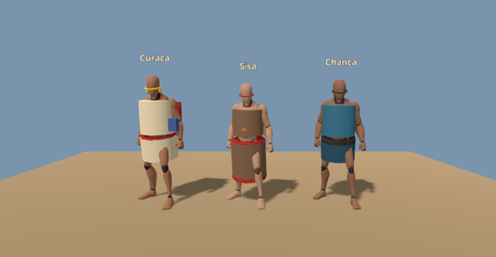

# Prototipo de maniquíes UAL1 y panel de objetivo

> Estado: **prototipo para aprobación**. No sustituye todavía al elenco UBC del
> juego. El objetivo es decidir el nuevo aspecto de los personajes y el panel de
> instrucciones antes de extenderlo a los diez roles.

## 1. Qué se ha probado

- **Tres maniquíes** con el mismo cuerpo UAL1 de Quaternius y tres looks:
  - **Curaca:** unku crema, faja y manto rojos, llauto y orejeras.
  - **Sisa:** anacu pardo con ruedo rojo, lliclla, faja, cinta y tupu.
  - **Chanca:** túnica teal, faldón oscuro, faja y cinta.
- **Mano del jugador** extraída del propio maniquí UAL1 (mano y antebrazo
  derechos, dos superficies) en un GLB estático.
- **Panel de objetivo** arriba a la izquierda, con fondo oscuro y texto cálido,
  integrado en el HUD actual.

Capturas:

| Prototipo | Imagen |
|---|---|
| Tres maniquíes |  |
| Mano UAL1 en primera persona |  |
| Panel de objetivo en la llacta |  |

## 2. Cómo se ejecuta

```bash
godot --path . res://tests/scenes/mannequin_prototype.tscn
godot --path . res://tests/scenes/mannequin_hand_prototype.tscn
```

La primera guarda `user://mannequin_prototype.png`; la segunda,
`user://mannequin_hand_prototype.png`. La mano se regenera con:

```bash
blender --background --factory-startup --python tools/blender_mannequin_hand.py
```

## 3. Qué se aprende del proyecto de referencia

`/home/jamaya/Projects/el-despertar-del-sol` usa un solo maniquí UAL1 para todos
los personajes y separa el aspecto en datos:

- `CharacterLook`: color de piel, color de juntas y lista de piezas.
- `LookPart`: caja, cilindro, anillo o disco; hueso, tamaño, offset, giro y color.
- `CharacterOutfit`: aplica las dos superficies del cuerpo y cuelga las piezas
  de huesos con `BoneAttachment3D`.

No hay caras, texturas de piel ni ropa esculpida. La identidad sale de la
silueta, los colores y cuatro o cinco piezas. Es un estilo de maniquí legible y
barato, y elimina los problemas de rostro y tela del elenco UBC.

De la interfaz se adopta el **panel de objetivo contextual**: arriba a la
izquierda, fondo oscuro, texto cálido y legible, con contadores cuando haga
falta. La referencia lo muestra al cambiar de objetivo y durante el combate, y
oculta el resto del HUD fuera de combate. Nuestro prototipo mantiene el panel
visible mientras la tarea está activa y conserva el diario para el detalle.

Otras ideas que merece la pena conservar:

- Pasos de misión como datos (`SliceStep`): objetivo, tipo, marcador, bandera,
  aviso y checkpoint.
- Checkpoint al empezar cada paso.
- HUD mínimo: barras solo cuando hacen falta y objetivo contextual.
- Códex con etiquetas (Documentado / Según los cronistas / Licencia del juego).
- Pruebas separadas de personaje, atuendo y HUD.

## 4. Qué falta para extenderlo

1. **Aprobar el estilo** con las tres capturas.
2. Crear los looks de los diez papeles (unku, anacu, lliclla, llauto, orejeras,
   tupu, chasqui, colores de facción).
3. Integrar el maniquí en `NpcActor`/`CharacterModelVisual` y retirar los UBC,
   caras, texturas, mandíbula, parpadeo, cejas y manto con muelles.
4. Multitud: maniquí liso sin piezas o con muy pocas, para no disparar draw calls.
5. Mano del jugador: integrarla en `FirstPersonHands` y en el arma; decidir si
   hace falta una pose de agarre además de la mano abierta.
6. Panel de objetivo: temporizador de 7 s al cambiar, aviso de objetivo nuevo y
   contadores; mantener el diario.
7. Pruebas de los diez looks, capturas, rendimiento y documentación final.

## 5. Decisiones y riesgos

- **Se usa el UAL1 Standard de Quaternius** (CC0), el mismo que ya estaba en
  `shared_assets/characters/mannequin/`. En el proyecto de referencia figura
  como recurso de prototipo; usarlo como estilo final es una decisión
  consciente de este proyecto.
- **La mano es estática**: no hay falanges articuladas. Es coherente con el
  maniquí y con la referencia, que es tercera persona y no tiene mano en primera
  persona. La adaptación a primera persona es nuestra.
- **Las piezas son primitivas**: a distancia se leen; de cerca son geométricas.
  Es el precio de un estilo consistente y barato.
- **El panel de objetivo** ya está en el HUD real, pero sin temporizador; el
  comportamiento transitorio de la referencia queda para la extensión.
- **Licencia y procedencia**: UAL1 es CC0; la mano es una derivación del mismo
  GLB; los scripts `CharacterLook`, `LookPart` y `CharacterOutfit` están
  adaptados del proyecto de referencia del mismo autor. Se registra en
  `shared_assets/characters/mannequin/LICENSE.md`.

## 6. Pruebas

- `test_mannequin_prototype.gd`: huesos reales de los tres looks, superficies y
  sustitución de atuendo, nodo `OutfitMannequin` y GLB de la mano.
- `test_hud_objective.gd`: el objetivo está arriba a la izquierda, con fondo y
  fuente de 26 px.
- Suite completa: **144 pruebas, 0 fallos**.
